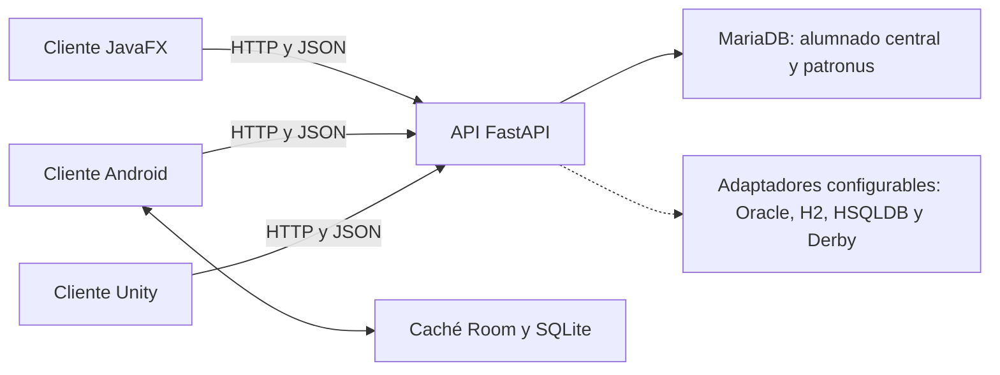

# Reto01 · Omni3 — Gestor Hogwarts

Entrega integrada en `main` de una API de alumnado distribuido y tres clientes. La integración conectó las puntas originales de `Api`, `androidapp`, `javafxapp`, `unityClient`, `development`, `prototipo` y `main` mediante commits de fusión; el [informe histórico](docs/integration-audit.md) recoge sus referencias de aquel momento. El prototipo es una implementación histórica diferente de la API principal.

## Arquitectura y componentes

| Carpeta | Función | Tecnología y estado comprobado |
|---|---|---|
| `api/` | API REST de alumnado y adaptadores a cinco motores. | Python 3.14, FastAPI; CRUD probado con MariaDB real. |
| `database/mariadb/` | Esquema mínimo para el recorrido verificable. | MariaDB 11.8; tablas de inicio comprobadas. |
| `gestorhogwartsjavafx/` | Cliente de escritorio con consulta, altas, edición y baja física por API. | JavaFX 21/Maven; 100 pruebas y empaquetado correctos. Pruebas manuales en dispositivos confirmadas por el equipo; Docker pendiente de verificación. |
| `gestorhogwartsmovil/` | Consulta y caché offline de alumnado con URL de API editable. | Kotlin/Android/Room; APK, 17 pruebas unitarias, 9 instrumentadas y lint correctos. |
| `Omni3_Hogwarts_Unity/` | Búsqueda y ficha de alumno/patronus. | Unity 6000.3.25f1; proyecto integrado. |
| `prototipo/` | Solución experimental anterior de sincronización. | API, clientes e infraestructura propios; no comparte esquema con `api/`. |
| `scripts/` | Comprobación de conectividad de la API. | PowerShell. |

Los clientes hablan por HTTP/JSON con `api/`. Android conserva una copia Room. La API principal usa MariaDB para altas y patronus y contiene adaptadores para Oracle, H2, HSQLDB y Derby.



## Arranque rápido comprobable

Requiere Docker Compose, Python 3.14 y una terminal PowerShell. Desde la raíz de un clon limpio de `main`:

```powershell
Copy-Item .env.example .env
# Cambia las contraseñas de ejemplo en .env.
docker compose up -d mariadb
Copy-Item api/.env.local.example api/.env
# Igualar usuario y contraseña de api/.env con .env.
py -3.14 -m venv api/.venv
& api/.venv/Scripts/python.exe -m pip install -e ./api
& api/.venv/Scripts/python.exe -m uvicorn proyecto_reto1.main:app --host 127.0.0.1 --port 8000
```

En otra terminal: `./scripts/check-api.ps1` debe informar la cantidad de alumnos. El esquema `database/mariadb/01_schema.sql` se aplica al crear un volumen nuevo de MariaDB. Si el volumen existía, revisa su contenido y aplica el SQL manualmente; no borres datos para repetir el inicio. En Linux usa `cp`, `python3.14 -m venv`, `api/.venv/bin/python` y `curl` para `/openapi.json` y `/alumnos`.

JavaFX: entra en `gestorhogwartsjavafx/`, ejecuta `mvn verify`, configura `GESTOR_API_URL` o el `config.properties` de esa carpeta y lanza `mvn javafx:run`. Requiere JDK 17+ y una instalación externa de Maven 3.9+; consulta el [README del cliente](gestorhogwartsjavafx/README.md). Android: abre `gestorhogwartsmovil/` en Android Studio con SDK 37; para usar la API local desde el emulador, establece `http://10.0.2.2:8000` en el campo **URL de la API** y pulsa **Aplicar**. La rama actual trae un túnel HTTPS como valor inicial de compilación, que no es necesario para esa prueba local. Unity: abre `Omni3_Hogwarts_Unity/` en Unity 6000.3.25f1, pulsa Play y cambia la dirección desde el campo **API URL**.

El equipo confirma pruebas manuales en dispositivos. El [registro de validación manual](docs/manual-validation.md) recoge la evidencia disponible, incluidas las pruebas físicas Android en Redmi Note 11 y Redmi Pad SE, y los datos que faltan para identificar las versiones y la cobertura de cada componente.

## Documentación y equipo

La [Wiki de GitHub](https://github.com/dm2-ethazi/Reto01-Omni3/wiki) reúne la instalación, el contrato, los datos, la arquitectura y el recorrido de demostración. Se mantiene en el repositorio independiente `https://github.com/dm2-ethazi/Reto01-Omni3.wiki.git`. El [informe de integración](docs/integration-audit.md) conserva el registro de las comprobaciones realizadas.

La [revisión de JavaFX del 21/10/2026](docs/javafx-review.md) recoge el entorno, el JAR generado, las traducciones y los límites observados. El [contrato técnico de referencia](gestorhogwartsjavafx/docs/00-contrato-tecnico.md) exige funciones que la entrega todavía no completa, como control de concurrencia, baja lógica y conectores/sincronización. Su estado se documenta expresamente; no se acredita un cambio de requisitos aprobado por el cliente.

Grupo **Omni3**: koldo ([@koldoaso](https://github.com/koldoaso)), henri ([@henritejada2006](https://github.com/henritejada2006)) y jairo ([@jairoben](https://github.com/jairoben)), identificados en el README de `javafxapp`.
