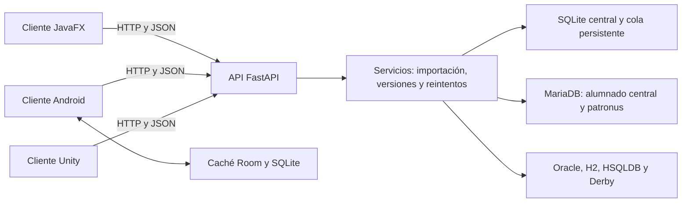

# Reto01 · Omni3 — Gestor Hogwarts

API de alumnado distribuido y tres clientes. La rama `integration` incorpora las correcciones del feedback ADAT y de la propuesta v6 aceptada. La integración original conectó las puntas de `Api`, `androidapp`, `javafxapp`, `unityClient`, `development`, `prototipo` y `main` mediante commits de fusión; el [informe histórico](docs/integration-audit.md) recoge sus referencias de aquel momento. El prototipo es una implementación histórica diferente de la API principal.

## Arquitectura y componentes

| Carpeta | Función | Tecnología y estado comprobado |
|---|---|---|
| `api/` | API REST, servicios de integración y repositorios. | Python 3.11+, FastAPI; MariaDB principal, SQLite de respaldo y cuatro fuentes reales verificadas. |
| `database/` | Esquemas centrales y semillas compatibles de las cuatro fuentes. | MariaDB 11.8, Oracle, H2, HSQLDB y Derby. |
| `gestorhogwartsjavafx/` | Consulta, altas, edición con versión y baja lógica de nuevos por API. | JavaFX 21/Maven; 102 pruebas correctas, JAR Windows y apertura local comprobados. |
| `gestorhogwartsmovil/` | Consulta y caché offline de alumnado con URL de API editable. | Kotlin/Android/Room; APK, 17 pruebas unitarias, 9 instrumentadas y lint correctos. |
| `Omni3_Hogwarts_Unity/` | Búsqueda y ficha de alumno/patronus. | Unity 6000.3.25f1; proyecto integrado. |
| `prototipo/` | Solución experimental anterior de sincronización. | API, clientes e infraestructura propios; no comparte esquema con `api/`. |
| `scripts/` | Arranque local, preparación de fuentes, comprobación de la API y demo ADAT. | PowerShell y Python. |

Los clientes hablan por HTTP/JSON con `api/`. Android conserva una copia Room. La API principal usa MariaDB como fuente de verdad de nuevos y vista central de históricos; Oracle, H2, HSQLDB y Derby mantienen sus propios registros. SQLite central es el respaldo de lectura y conserva una cola de refrescos con cinco intentos, FAILED y control de saturación. La copia Room pertenece al cliente y es independiente de SQLite central.



## Arranque rápido comprobable

Requiere Docker Compose, Python 3.11+, Java 21+ y una terminal PowerShell. Los ejemplos usan Python 3.14. Desde la raíz:

```powershell
Copy-Item .env.example .env
# Cambia las contraseñas de ejemplo en .env.
Copy-Item api/.env.example api/.env
# Igualar credenciales en ambos archivos; ORACLE_PASSWORD de api/.env
# corresponde a ORACLE_USER_PASSWORD de .env raíz.
docker compose up -d
py -3.14 -m venv api/.venv
& api/.venv/Scripts/python.exe -m pip install --upgrade pip
& api/.venv/Scripts/python.exe -m pip install -e ./api --group ./api/pyproject.toml:dev
& api/.venv/Scripts/python.exe scripts/seed-origins.py
& api/.venv/Scripts/python.exe -m uvicorn proyecto_reto1.main:app --host 127.0.0.1 --port 8000
```

En otra terminal, `./scripts/check-api.ps1` comprueba la identificación R01. Ejecuta `POST /sync` para importar los datos de ejemplo antes de abrir los clientes. `scripts/verify-adat.py` demuestra el recorrido HTTP y comprueba ambas centrales; consulta el [README de la API](api/README.md) para importación selectiva, caída de MariaDB, concurrencia y pruebas. Los volúmenes Docker y `api/data/` deben conservarse al reiniciar. En Linux usa `cp`, `python3.14` y `api/.venv/bin/python`.

JavaFX: entra en `gestorhogwartsjavafx/`, ejecuta `mvn verify`, configura `GESTOR_API_URL` o el `config.properties` de esa carpeta y lanza `mvn javafx:run`. Requiere JDK 17+ y una instalación externa de Maven 3.9+; consulta el [README del cliente](gestorhogwartsjavafx/README.md). Android: abre `gestorhogwartsmovil/` en Android Studio con SDK 37; para usar la API local desde el emulador, establece `http://10.0.2.2:8000` en el campo **URL de la API** y pulsa **Aplicar**. La rama actual trae un túnel HTTPS como valor inicial de compilación, que no es necesario para esa prueba local. Unity: abre `Omni3_Hogwarts_Unity/` en Unity 6000.3.25f1, pulsa Play y cambia la dirección desde el campo **API URL**.

### Demo local con backend y JavaFX

Con el entorno `api/.venv` ya instalado, Docker encendido y Maven 3.9+ disponible,
esta alternativa usa el proyecto Compose `r01-adat-validation` y puertos propios
para no ocupar el 3306 de otra MariaDB:

```powershell
# Solo en la primera preparacion; conserva la configuracion si ya existe.
New-Item -ItemType Directory -Force api/data | Out-Null
if (-not (Test-Path api/data/validation.env)) {
    Copy-Item api/.env.demo.example api/data/validation.env
}
# Cambiar las contrasenas de ejemplo en api/data/validation.env.
mvn -f gestorhogwartsjavafx/pom.xml clean package '-Djavafx.platform=win'
powershell -ExecutionPolicy Bypass -File scripts/start-local.ps1
```

El script prepara las cuatro fuentes, inicia la API en `http://127.0.0.1:8000`,
importa las semillas y abre JavaFX apuntando a esa URL. Swagger está en `/docs`.
Admite `-NoJava`, `-Port 8001` y `-EnvFile ruta/al/archivo.env`. Los logs y PID
quedan en `api/data/local-*`. La configuración privada, SQLite y los artefactos
compilados no se suben a Git. Para reutilizar este entorno no sobrescribas su
archivo de configuración ni elimines sus volúmenes.

En esta demo MariaDB escucha en el puerto **33306** y la copia central está en
`api/data/validation-final.sqlite3`. La ruta real depende de `SQLITE_PATH`;
`data/central.sqlite3` es el valor por defecto de la configuración general.
En JavaFX, **SQLite** consulta esa copia mediante `/alumnos?lectura=sqlite`.
La columna **Origen** conserva MariaDB, Oracle, H2, HSQLDB o Derby: indica de dónde
procede el alumno, aunque se esté consultando su copia SQLite.

El equipo confirma pruebas manuales en dispositivos. El [registro de validación manual](docs/manual-validation.md) recoge la evidencia disponible, incluidas las pruebas físicas Android en Redmi Note 11 y Redmi Pad SE, y los datos que faltan para identificar las versiones y la cobertura de cada componente.

## Documentación y equipo

La [Wiki de GitHub](https://github.com/dm2-ethazi/Reto01-Omni3/wiki) reúne la instalación, el contrato, los datos, la arquitectura y el recorrido de demostración. Se mantiene en el repositorio independiente `https://github.com/dm2-ethazi/Reto01-Omni3.wiki.git`. El [informe de integración](docs/integration-audit.md) conserva el registro de las comprobaciones realizadas.

La [validación ADAT y propuesta v6 del 09/11/2026](docs/adat-validation.md) recoge las correcciones de la API, las condiciones de fallo contratadas y la demostración real. La [revisión de JavaFX del 21/10/2026](docs/javafx-review.md) conserva el estado histórico anterior; el [contrato técnico de referencia](gestorhogwartsjavafx/docs/00-contrato-tecnico.md) sigue documentando también requisitos de interfaz ajenos a esta corrección.

Grupo **Omni3**: koldo ([@koldoaso](https://github.com/koldoaso)), henri ([@henritejada2006](https://github.com/henritejada2006)) y jairo ([@jairoben](https://github.com/jairoben)), identificados en el README de `javafxapp`.

## Copiar y pegar: montar y ejecutar desde la raíz

**Windows:** instala **Python 3.11+ de 64 bits** con el lanzador `py`, **JDK 21+
de 64 bits** y **Docker Desktop**. Abre Docker Desktop y espera a que esté listo.
Los comandos `py`, `java`, `javaw` y `docker` deben estar en el `PATH`. La compilación
usa Maven dentro de Docker. Hace falta Internet para descargar las dependencias
e imágenes la primera vez.

Abre **PowerShell en la carpeta raíz `Reto01-Omni3`**, donde está `compose.yaml`,
y pega **este bloque entero de una vez**. Si ya tienes JavaFX abierto, ciérralo
antes de repetirlo para permitir recompilar su JAR.

El bloque instala el backend, genera contraseñas locales automáticamente la
primera vez, compila JavaFX para Windows y arranca **las cinco bases, SQLite
central, la API y JavaFX**. Conserva la configuración y los datos existentes.

```powershell
& {
    $ErrorActionPreference = 'Stop'

    # 1. Comprobar carpeta y herramientas antes de preparar nada.
    if (-not (Test-Path './compose.yaml') -or -not (Test-Path './api/pyproject.toml')) {
        throw 'Abre PowerShell en la raiz Reto01-Omni3 y vuelve a pegar el bloque.'
    }
    foreach ($tool in @('py', 'java', 'javaw', 'docker', 'powershell')) {
        if (-not (Get-Command $tool -ErrorAction SilentlyContinue)) {
            throw "Falta $tool en el PATH. Instala los requisitos y abre otra terminal."
        }
    }
    docker info --format '{{.ServerVersion}}'
    if ($LASTEXITCODE -ne 0) { throw 'Abre Docker Desktop y espera a que este listo.' }
    docker compose version
    if ($LASTEXITCODE -ne 0) { throw 'Docker Compose no esta disponible.' }
    java --version
    if ($LASTEXITCODE -ne 0) { throw 'Comprueba la instalacion de JDK 21 o superior.' }
    py -3 -c "import sys, struct; assert sys.version_info >= (3, 11) and struct.calcsize('P') == 8, 'Se requiere Python 3.11+ de 64 bits'"
    if ($LASTEXITCODE -ne 0) { throw 'Comprueba la instalacion de Python 3.11+ de 64 bits.' }

    # 2. Crear el entorno Python si falta e instalar las dependencias.
    if (-not (Test-Path './api/.venv/Scripts/python.exe')) {
        py -3 -m venv api/.venv
        if ($LASTEXITCODE -ne 0) { throw 'No se pudo crear api/.venv.' }
    }
    & ./api/.venv/Scripts/python.exe -m pip install --upgrade pip
    if ($LASTEXITCODE -ne 0) { throw 'No se pudo actualizar pip.' }
    & ./api/.venv/Scripts/python.exe -m pip install -e ./api --group ./api/pyproject.toml:dev
    if ($LASTEXITCODE -ne 0) { throw 'No se pudieron instalar las dependencias Python.' }

    # 3. Generar la configuracion privada una sola vez, sin editar archivos a mano.
    New-Item -ItemType Directory -Force './api/data' | Out-Null
    if (-not (Test-Path './api/data/validation.env')) {
        $config = Get-Content './api/.env.demo.example' -Raw
        $config = $config.Replace('change-demo-root', [guid]::NewGuid().ToString('N'))
        $config = $config.Replace('change-demo-maria', [guid]::NewGuid().ToString('N'))
        $config = $config.Replace('change-demo-oracle', [guid]::NewGuid().ToString('N'))
        Set-Content './api/data/validation.env' -Value $config -Encoding ASCII
    }

    # 4. Compilar JavaFX para Windows usando Maven de Docker.
    $repo = (Get-Location).Path
    docker run --rm --mount "type=bind,source=$repo,target=/workspace" --mount 'type=volume,source=r01-adat-validation_maven_cache,target=/root/.m2' -w /workspace/gestorhogwartsjavafx maven:3.9-eclipse-temurin-21 mvn -B -q clean package '-Djavafx.platform=win' '-DskipTests'
    if ($LASTEXITCODE -ne 0) { throw 'No se pudo compilar JavaFX. Cierra la aplicacion si estaba abierta.' }

    # 5. Preparar las fuentes, arrancar la API, importar alumnos y abrir JavaFX.
    powershell -NoProfile -ExecutionPolicy Bypass -File './scripts/start-local.ps1'
    if ($LASTEXITCODE -ne 0) { throw 'Fallo el arranque. Revisa el mensaje anterior y api/data/local-*.log.' }

    Write-Host 'LISTO: JavaFX conectado a http://127.0.0.1:8000'
    Write-Host 'Swagger: http://127.0.0.1:8000/docs'
    Write-Host 'Estado:  http://127.0.0.1:8000/health'
    Write-Host 'SQLite:  api/data/validation-final.sqlite3 (ruta de la plantilla de demo)'
}
```

La primera ejecución puede tardar varios minutos, especialmente al descargar e
iniciar Oracle. JavaFX se abre con los alumnos de ejemplo; las altas hechas desde
él se guardan en MariaDB y se refrescan en SQLite. Puedes elegir **SQLite** en el
selector para comprobar la copia. La configuración de demo publica MariaDB en
**33306**, Oracle en **31521**, H2 en **39092**, HSQLDB en **39001** y Derby en
**31527**. El puerto **8000** debe estar libre o tener ya esta misma API ejecutándose.
Una configuración existente conserva sus valores, incluidos sus puertos y `SQLITE_PATH`.

Para los siguientes arranques, con Docker Desktop encendido, basta con pegar esto
desde la misma carpeta:

```powershell
powershell -NoProfile -ExecutionPolicy Bypass -File ./scripts/start-local.ps1
```

Android y Unity usan la misma API: en el emulador Android configura
`http://10.0.2.2:8000`; en Unity, `http://127.0.0.1:8000`. Su compilación y ejecución
requieren Android Studio y Unity Editor, respectivamente, según sus README.
