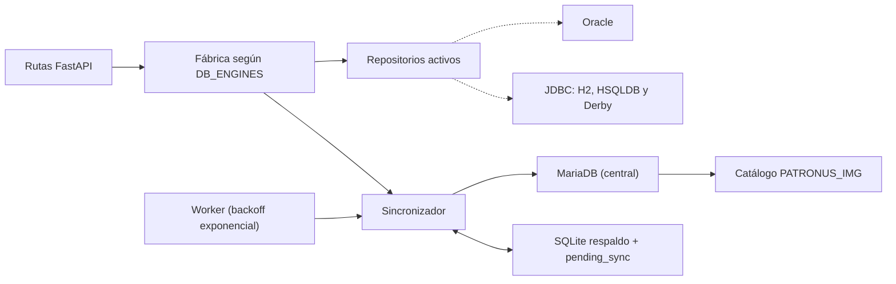

# API Alumnos (Reto 1 / R01)

API REST que expone el alumnado de Hogwarts repartido en **5 bases de datos diferentes**
(Oracle, MariaDB, H2, HSQLDB y Derby) con una única interfaz: no importa en qué motor
esté el registro, la API lo localiza y actúa sobre él.

- **Stack**: Python 3.14 · FastAPI · Pydantic v2 · Uvicorn
- **Conexiones**: `oracledb` y `pymysql` (nativas) y `jaydebeapi` + JPype (JDBC) para H2, HSQLDB y Derby
- **Respaldo central**: SQLite (`SQLITE_PATH`) con cola `pending_sync` y worker de reintentos
- **Borrado lógico**: las bajas conservan el registro (`activo = false`, `fecha_baja`)
- **Concurrencia optimista**: ediciones y bajas exigen la versión leída (`If-Match` / `version`)
- **Patronus obligatorio** en altas
- **Estado**: `GET /status` con la referencia `R01`
- **Documentación interactiva**: `/docs` (Swagger UI), `/redoc` y `/openapi.json`

---

## Estructura del proyecto

```
api/
├── .env                    # credenciales y URLs (no se sube a git)
├── .env.example            # plantilla de configuración
├── Dockerfile              # imagen de la API para Docker Compose (perfil 'api')
├── jars/                   # drivers JDBC: h2.jar, hsqldb.jar, derbyclient.jar, derbyshared.jar
├── pyproject.toml
├── tests/                  # tests de integración (pytest) de los 6 requisitos R01
└── src/proyecto_reto1/
    ├── __init__.py         # documentación del paquete + entrypoint `proyecto-reto1`
    ├── config.py           # Settings cargados desde .env (rutas absolutas)
    ├── main.py             # app FastAPI principal (lifespan: worker de sincronización)
    ├── main_tareas.py      # app de ejemplo independiente (API Tareas en memoria)
    ├── sync_worker.py      # worker que reintenta pending_sync con backoff exponencial
    ├── api/
    │   ├── __init__.py
    │   ├── alumnos.py      # endpoints REST
    │   └── estado.py       # GET /status (referencia R01)
    └── db/
        ├── __init__.py
        ├── base.py         # modelos Pydantic + helpers + Protocolo del repositorio
        ├── factory.py      # crea las fuentes activas según DB_ENGINES e inicia la JVM
        ├── jdbc.py         # repositorio genérico JDBC (base de H2/HSQLDB/Derby)
        ├── h2.py           # RepositorioH2 (Hufflepuff)
        ├── hsqldb.py       # RepositorioHSQLDB (Slytherin)
        ├── derby.py        # RepositorioDerby (Gryffindor)
        ├── oracle.py       # RepositorioOracle (Ravenclaw)
        ├── mariadb.py      # RepositorioMariaDB (Hogwarts, base central)
        ├── sqlite_backup.py    # respaldo SQLite + cola pending_sync
        └── sincronizacion.py   # capa MariaDB + SQLite (fallback y escrituras dobles)
```

## Requisitos

- Python **3.14** y [uv](https://docs.astral.sh/uv/) (o un virtualenv equivalente)
- **Java/JVM** en el `PATH` (necesaria para H2, HSQLDB y Derby vía JDBC)
- Las 5 bases de datos accesibles con los datos cargados (tabla `ALUMNOS` en cada una)
- MariaDB con la tabla `PATRONUS_IMG` cargada (ver [Tabla PATRONUS_IMG](#tabla-patronus_img))

## Instalación y arranque

```bash
uv sync                      # crea .venv e instala dependencias
cp .env.example .env         # y completa credenciales
uv run uvicorn proyecto_reto1.main:app --reload
```

Alternativa (usa el entrypoint definido en `pyproject.toml`):

```bash
uv run proyecto-reto1
```

La API queda en `http://127.0.0.1:8000` (Swagger en `http://127.0.0.1:8000/docs`).

## Configuración (`.env`)

| Variable | Descripción |
|---|---|
| `DB_ENGINES` | Motores activos, separados por coma (`oracle,mariadb,h2,hsqldb,derby`). Si quitas uno, la API deja de usarlo |
| `JARS_DIR` | Carpeta con los `.jar` JDBC (por defecto `jars`, resuelta a ruta absoluta) |
| `ORACLE_HOST/PORT/SERVICE/USER/PASSWORD` | Oracle (Ravenclaw) |
| `MARIADB_HOST/PORT/DATABASE/USER/PASSWORD` | MariaDB (Hogwarts, base `r01_central`) |
| `H2_URL/USER/PASSWORD` | H2 (Hufflepuff), URL `jdbc:h2:tcp://localhost:9092/r01db` |
| `HSQLDB_URL/USER/PASSWORD` | HSQLDB (Slytherin), URL `jdbc:hsqldb:hsql://localhost:9001/slytherin` |
| `DERBY_URL/USER/PASSWORD` | Derby (Gryffindor), URL `jdbc:derby://localhost:1527/db` |
| `SQLITE_PATH` | Fichero SQLite de respaldo central (por defecto `data/respaldo.db`, resuelto a ruta absoluta). En Docker: `/data/api/respaldo.db` (volumen `api_data`) |
| `SYNC_INTERVALO_SEGUNDOS` | Segundos entre pasadas del worker de sincronización (por defecto `10`) |
| `SYNC_BACKOFF_INICIAL_SEGUNDOS` | Primer intervalo de reintento (por defecto `5`; se duplica con cada fallo) |
| `SYNC_BACKOFF_MAX_SEGUNDOS` | Techo del backoff exponencial (por defecto `300`) |
| `SYNC_MAX_INTENTOS` | Intentos máximos antes de marcar una operación como fallida (por defecto `8`) |

> **Nota**: `.env` y `JARS_DIR` se resuelven como rutas absolutas respecto a la carpeta `api/`,
> por lo que la API funciona correctamente independientemente del directorio desde el que se ejecute.

Las 5 fuentes y su etiqueta `casa`:

| Motor | `casa` | Tipo de repositorio |
|---|---|---|
| Oracle | Ravenclaw | `RepositorioOracle` (oracledb) |
| MariaDB | Hogwarts | `RepositorioMariaDB` (pymysql) — base central |
| H2 | Hufflepuff | `RepositorioH2` → JDBC |
| HSQLDB | Slytherin | `RepositorioHSQLDB` → JDBC |
| Derby | Gryffindor | `RepositorioDerby` → JDBC |

## Modelo de datos

### Tabla ALUMNOS (en los 5 motores)

| Campo | Tipo | Restricciones en la API |
|---|---|---|
| `ID` | texto (DNI, 1-10 chars) | clave primaria, obligatorio en POST, **no se puede modificar** |
| `NOMBRE` | texto | obligatorio, 1-100 |
| `APELLIDO` | texto | opcional, `null` o `""` → `NULL` |
| `SEXO` | texto | opcional, solo `H`, `M` o `S` |
| `PATRONUS` | texto | **obligatorio en altas** (POST), se guarda el nombre **en inglés** (validado contra `PATRONUS_IMG`); en ediciones, si se envía no puede quedar vacío |
| `IMAGEN` | texto | opcional, URL o ruta de la imagen del alumno (máx. 500) |
| `ACTIVO` | TINYINT(1) DEFAULT 1 | borrado lógico: la baja pone `0` sin borrar la fila |
| `FECHA_BAJA` | DATETIME NULL | rellena al producirse la baja lógica |
| `VERSION` | INT DEFAULT 1 | control de concurrencia optimista (sube en cada modificación) |
| `UPDATED_AT` | TIMESTAMP | se actualiza solo en cada modificación |

> `ACTIVO`, `FECHA_BAJA` y `VERSION` existen en MariaDB (central) y en el respaldo
> SQLite. En los motores clásicos (Oracle, H2, HSQLDB, Derby) la API los acepta y
> los aplica **solo si su esquema tiene esas columnas** (ver migración abajo);
> si no, mantiene el comportamiento histórico.

**Migración idempotente** (segura de ejecutar tantas veces como se quiera):

```bash
docker exec -i r01-mariadb mariadb -uexample -pexample r01_central \
  < ../database/mariadb/migracion_v2.sql
```

`casa` y `patronus_url` **no** son columnas: los añade la API en la respuesta
(`casa` según la fuente que respondió, `patronus_url` consultando `PATRONUS_IMG`).

### Tabla PATRONUS_IMG

Catálogo de patronus con imagen, almacenada **solo en MariaDB** (`r01_central`).
Se usa para validar el patronus en el POST y para devolver la imagen en el GET.

| Campo | Tipo | Descripción |
|---|---|---|
| `ID` | INT autoincrement | clave primaria |
| `NOM_ENG` | varchar(100) | nombre en inglés (único) — **única columna que consulta la API** |
| `URL` | varchar(500) | URL de la imagen del patronus |

Para crear la tabla y cargar los datos:

```bash
docker compose -f ../compose.yaml up -d mariadb  # desde api/
# En un volumen nuevo, Compose aplica database/mariadb/01_schema.sql.
```

Si el volumen ya existía, el SQL de inicio no se reaplica. Inspecciona las
tablas y aplica `database/mariadb/01_schema.sql` manualmente sin borrar datos.
Para la demostración local con solo MariaDB, copia `api/.env.local.example`
a `api/.env` y ajusta usuario y contraseña para que coincidan con el `.env`
de la raíz. Los otros cuatro motores requieren esquemas `ALUMNOS` que no se
incluyen en esta rama integrada; el SQL de `prototipo/` usa otro modelo.

---

## Endpoints

| Método | Ruta | Éxito | Descripción |
|---|---|---|---|
| `GET` | `/alumnos` | 200 | Lista el alumnado **activo** de las 5 bases de datos (`?incluir_inactivos=true` incluye bajas lógicas) |
| `GET` | `/alumnos?nombre={texto}` | 200 | Busca alumnos cuyo nombre **empiece por** el texto indicado |
| `GET` | `/alumnos/{dni}` | 200 | Busca el DNI en cada fuente y devuelve la primera coincidencia con `patronus_url` |
| `GET` | `/patronus` | 200 | Lista el catálogo de patronus (solo MariaDB) |
| `POST` | `/alumnos` | 201 | Crea el alumno en MariaDB. **`patronus` obligatorio** (validado contra `PATRONUS_IMG`) |
| `PUT` | `/alumnos/{dni}` | 200 | Actualiza el registro. **Requiere versión** (`If-Match` o campo `version`) |
| `DELETE` | `/alumnos/{dni}` | 204 | **Baja lógica**: `activo = 0`, `fecha_baja = NOW()`. Requiere versión |
| `GET` | `/status` | 200 | Estado del sistema: `reto: "R01"`, MariaDB, SQLite, pendientes y fecha |

Códigos de error comunes: **404** DNI inexistente o dado de baja · **409** DNI duplicado
o **versión desactualizada** (devuelve `version_actual`) · **422** validación (patronus
faltante/inexistente, sexo fuera de `HMS`, etc.) · **428** edición/baja sin la versión
leída · **503** una fuente clásica no responde.

Cabeceras de respuesta especiales:

| Cabecera | Significado |
|---|---|
| `X-Data-Source: sqlite` | La lectura se sirvió del respaldo porque MariaDB no respondía |
| `X-Pending-Sync: true` | La escritura se guardó en SQLite y quedó en cola `pending_sync` |

### GET /alumnos

```bash
curl http://127.0.0.1:8000/alumnos
```

```json
[
  {
    "id": "10000000Z",
    "nombre": "Abigail",
    "apellido": "Pugh",
    "sexo": "M",
    "patronus": null,
    "patronus_url": null,
    "imagen": null,
    "casa": "Slytherin"
  }
]
```

### GET /alumnos?nombre={texto}

Búsqueda por **prefijo** de nombre (no distingue mayúsculas/minúsculas). Devuelve las
coincidencias de las 5 bases de datos, ordenadas por nombre.

```bash
curl "http://127.0.0.1:8000/alumnos?nombre=Al"
```

```json
[
  { "id": "10000267M", "nombre": "Alannis", "apellido": null, "sexo": "M", "patronus": null, "patronus_url": null, "imagen": null, "casa": "Ravenclaw" },
  { "id": "10000470W", "nombre": "Albert", "apellido": "Nott", "sexo": "H", "patronus": null, "patronus_url": null, "imagen": null, "casa": "Gryffindor" },
  { "id": "10000773Y", "nombre": "Alecto", "apellido": "Carrow", "sexo": "M", "patronus": null, "patronus_url": null, "imagen": null, "casa": "Hufflepuff" }
]
```

Si no se pasa el parámetro `nombre`, se comporta como `GET /alumnos` (lista completa).

### GET /alumnos/{dni}

```bash
curl http://127.0.0.1:8000/alumnos/10000000Z
```

```json
{
  "id": "10000000Z",
  "nombre": "Abigail",
  "apellido": "Pugh",
  "sexo": "M",
  "patronus": "Wolf",
  "patronus_url": "https://upload.wikimedia.org/wikipedia/commons/6/68/Eurasian_wolf_2.jpg",
  "imagen": null,
  "casa": "Slytherin"
}
```

El campo `patronus_url` se busca en `PATRONUS_IMG` consultando el valor de `patronus`
por la columna `NOM_ENG`. Si el patronus no está en el catálogo o `patronus` es `null`,
el campo se devuelve como `null`.

### GET /patronus

Devuelve el catálogo completo de patronus (nombre en inglés + imagen). Requiere que el
motor `mariadb` esté activo en `DB_ENGINES`, ya que la tabla solo existe allí.

```bash
curl http://127.0.0.1:8000/patronus
```

```json
[
  { "nom_eng": "Wolf", "url": "https://upload.wikimedia.org/wikipedia/commons/6/68/Eurasian_wolf_2.jpg" },
  { "nom_eng": "Stag", "url": "https://example.com/stag.jpg" }
]
```

### POST /alumnos

El campo `patronus` es **obligatorio** en las altas y se valida contra la columna
`NOM_ENG` de la tabla `PATRONUS_IMG`, por lo que debe enviarse **el nombre en inglés**
(`"Wolf"`, `"Stag"`, `"Otter"`...).

```bash
curl -X POST http://127.0.0.1:8000/alumnos \
  -H "Content-Type: application/json" \
  -d '{"id":"10009999X","nombre":"Harry","apellido":"Potter","sexo":"H","patronus":"Stag","imagen":"https://example.com/harry.jpg"}'
```

```json
{
  "id": "10009999X",
  "nombre": "Harry",
  "apellido": "Potter",
  "sexo": "H",
  "patronus": "Stag",
  "patronus_url": null,
  "imagen": "https://example.com/harry.jpg",
  "casa": "Hogwarts",
  "activo": true,
  "fecha_baja": null,
  "version": 1
}
```

Respuestas:
- `201` creado (en MariaDB y espejo en SQLite; si MariaDB está caído, `X-Pending-Sync: true`)
- `409` el DNI ya existe en alguna de las 5 fuentes (aunque esté dado de baja)
- `422` **falta `patronus`** o viene vacío / el patronus no existe en `PATRONUS_IMG`
- `422` datos no válidos (nombre vacío, sexo fuera de `HMS`, etc.)

```bash
# Sin patronus → 422 con mensaje claro
curl -i -X POST http://127.0.0.1:8000/alumnos \
  -H "Content-Type: application/json" -d '{"id":"10008888Y","nombre":"Sin","patronus":""}'
```

### PUT /alumnos/{dni}

Envía **solo los campos que quieras cambiar**; los omitidos no se tocan y los que envíes
como `null` (o `""`) se guardan como `NULL`, salvo `patronus`: si se envía, no puede
quedar vacío. El `ID` se toma de la URL y no es editable.

**Control de concurrencia optimista**: la petición debe llevar la versión que leíste
(cabecera `If-Match` o campo `version`). Si no la envías → `428`; si está desactualizada
→ `409` con la versión actual. La versión sube en cada modificación.

```bash
# leer la versión actual
curl -s http://127.0.0.1:8000/alumnos/10000000Z | grep version

# editar con If-Match
curl -X PUT http://127.0.0.1:8000/alumnos/10000000Z \
  -H "Content-Type: application/json" -H "If-Match: 1" \
  -d '{"patronus":"Stag"}'

# o con el campo version en el cuerpo
curl -X PUT http://127.0.0.1:8000/alumnos/10000000Z \
  -H "Content-Type: application/json" -d '{"apellido":"","sexo":"H","version":2}'
```

Respuesta `200` con el alumno ya actualizado · `404` si el DNI no está en ninguna fuente ·
`409` versión desactualizada (devuelve `detail.version_actual`) · `428` sin versión ·
`422` si el cuerpo está vacío, `patronus` viene vacío o algún valor no cumple las
restricciones.

### DELETE /alumnos/{dni} (baja lógica)

**No borra el registro**: lo marca como inactivo (`activo = false`, `fecha_baja` rellena)
y sube su versión. Requiere la versión leída (`If-Match` o `?version=N`).

```bash
curl -X DELETE http://127.0.0.1:8000/alumnos/10009999X -H "If-Match: 1"
# alternativa: curl -X DELETE ".../alumnos/10009999X?version=1"
```

- `204` baja aplicada (o **idempotente** si ya estaba inactivo) · `404` DNI inexistente ·
  `409` versión desactualizada · `428` sin versión · `503` si una fuente clásica no responde.

El alumno sigue visible con `?incluir_inactivos=true`:

```bash
curl "http://127.0.0.1:8000/alumnos/10009999X?incluir_inactivos=true"
```

### GET /status

Estado del sistema con la referencia del reto **R01**:

```bash
curl http://127.0.0.1:8000/status
```

```json
{
  "reto": "R01",
  "estado": "ok",
  "mariadb": "up",
  "sqlite": "up",
  "operaciones_pendientes": 0,
  "operaciones_fallidas": 0,
  "fecha_hora": "2026-10-28T13:00:00+00:00",
  "servidor": "r01-api"
}
```

`estado` es `ok` (ambas bases responden), `degradado` (solo el respaldo SQLite) o
`down` (ninguna responde). `operaciones_fallidas` recoge las operaciones de
`pending_sync` que agotaron los reintentos.

---

## Cómo funciona por dentro



La fábrica crea únicamente los repositorios indicados en `DB_ENGINES`.

1. `config.py` lee `.env` (ruta absoluta) y `factory.py` construye la lista de repositorios
   según `DB_ENGINES`. Si hay fuentes JDBC, arranca **una única JVM** (`jdbc.iniciar_jvm`)
   con los `.jar` correspondientes (también resueltos a ruta absoluta).
2. `db/base.py` define los **modelos Pydantic**, los helpers compartidos
   (`fila_a_alumno`, `campos_a_actualizar`) y el **Protocolo `RepositorioAlumnos`**
   (`listar`, `buscar_por_nombre`, `obtener`, `actualizar`, `eliminar`). Todos los motores
   cumplen ese contrato, así que la capa HTTP no distingue entre Oracle, MariaDB, H2,
   HSQLDB ni Derby.
3. `api/alumnos.py` inyecta las fuentes con `Depends(get_repositorios)` y recorre la lista:
   lectura = primera coincidencia; escritura = todas las coincidencias. La parte central
   (MariaDB) pasa por el `Sincronizador`.
4. Todas las sentencias SQL van **parametrizadas** (`?`, `%s` o `:nombre` según el motor),
   con las columnas blanqueadas por la API, y hacen `commit` explícito.
5. El **buscador por nombre** (`?nombre=`) usa `WHERE UPPER(NOMBRE) LIKE UPPER(prefijo || '%')`
   en cada motor, ordenado por nombre. Se ejecuta en las 5 fuentes y se concatenan los resultados.
6. El **patronus** se valida en el POST consultando `NOM_ENG` en `PATRONUS_IMG` (MariaDB).
   En el GET `/alumnos/{dni}` se busca la URL de la imagen en esa misma columna.

### Respaldo SQLite y sincronización (Reto R01)

- **Esquema equivalente**: la tabla `alumnos` del SQLite (`SQLITE_PATH`) replica los
  campos de MariaDB más `activo`, `fecha_baja`, `version` y `updated_at`. Solo respalda
  los datos gestionados por la API, no las bases de origen.
- **Escritura doble**: cada alta, edición o baja lógica se aplica en MariaDB y se
  refleja en SQLite. Si MariaDB falla, la operación se guarda en SQLite y se registra en
  `pending_sync` (id, operación, payload JSON, intentos, último error, estado, fechas),
  y la respuesta lleva `X-Pending-Sync: true`.
- **Lectura degradada**: si MariaDB no responde, las lecturas se sirven desde SQLite con
  la cabecera `X-Data-Source: sqlite`.
- **Worker con reintentos**: `sync_worker.py` corre en un hilo daemon (arrancado por el
  lifespan de FastAPI) y vacía `pending_sync` en orden FIFO cuando MariaDB vuelve,
  esperando un **backoff exponencial** (`SYNC_BACKOFF_INICIAL × 2^intentos`, tope
  `SYNC_BACKOFF_MAX_SEGUNDOS`). Al agotar `SYNC_MAX_INTENTOS` la operación queda como
  `fallido` y es visible en `GET /status`. Tras aplicar operaciones se refresca el
  respaldo con el estado real de MariaDB.

### Docker Compose

Además de las bases de datos, la rama v2 incluye un perfil `api` con la imagen de la
API y el **volumen `api_data`** para el fichero SQLite:

```bash
docker compose --profile api up -d --build   # MariaDB + API en :8000
docker compose --profile api down            # para ambos
```

`SQLITE_PATH=/data/api/respaldo.db` vive dentro del volumen, así que los datos y la cola
de sincronización **sobreviven reinicios** del contenedor.

### Migración de una base existente

Si el volumen de MariaDB ya existía antes del esquema v2, aplica la migración idempotente:

```bash
docker exec -i r01-mariadb mariadb -uexample -pexample r01_central \
  < ../database/mariadb/migracion_v2.sql
```

## API Tareas (ejemplo)

`main_tareas.py` es una app FastAPI **independiente** de esta API: un CRUD de tareas
guardadas en una lista de Python (en memoria), pensada como plantilla de práctica.

```bash
uv run uvicorn proyecto_reto1.main_tareas:app --reload
```

## Tests

Hay tests de integración (`pytest` + `httpx`) que cubren los 6 requisitos del reto.
Necesitan la MariaDB de Docker Compose y pausan/despausan el contenedor `r01-mariadb`
para simular caídas:

```bash
docker compose -f ../compose.yaml up -d mariadb   # desde api/
uv run pytest -v
```

| Test | Requisito demostrado |
|---|---|
| `test_status_devuelve_reto_r01` | `GET /status` con `"reto": "R01"` |
| `test_alta_rechazada_sin_patronus` / `_vacio` | Patronus obligatorio (422) |
| `test_baja_logica_conserva_el_registro` | Borrado lógico verificado también en SQL |
| `test_baja_logica_es_idempotente` | Baja repetida → 204 sin cambios |
| `test_edicion_con_version_desactualizada_devuelve_409` | Concurrencia optimista (409 + versión actual) |
| `test_edicion_sin_version_devuelve_428` | Versión obligatoria en ediciones/bajas |
| `test_lectura_desde_respaldo_con_mariadb_caido` | Lecturas desde SQLite con `X-Data-Source: sqlite` |
| `test_escritura_con_mariadb_caido_se_encola_y_se_sincroniza` | `pending_sync` + reintento tras recuperar MariaDB |

También hay un script equivalente con `curl` en la raíz del repositorio:
`scripts/test_v2.ps1` (ver «Cómo probar cada punto» arriba).
