# Pruebas manuales en dispositivos

Actualizado el 12/11/2026. El equipo confirma las pruebas manuales de JavaFX, Android y Unity.

## Capturas del 12 de noviembre de 2026

### Arranque y carga de las fuentes

La terminal muestra los cinco contenedores en estado Healthy y un catálogo de 152 Patronus. El cargador inserta y vuelve a leer 203 alumnos en Oracle, 212 en H2, 267 en HSQLDB y 303 en Derby. La última línea visible anuncia el comienzo de la importación a las centrales.

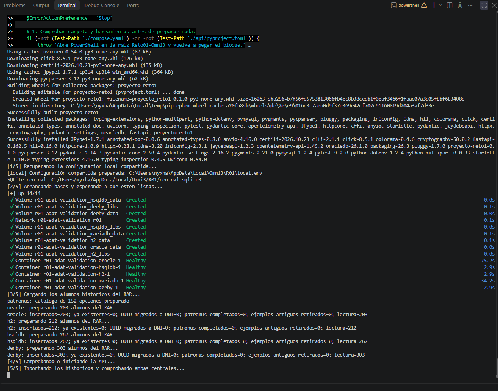

### Estado de la API en JavaFX

En System status, JavaFX muestra el identificador R01, el estado OK y la hora de respuesta del servidor (19:25:24 UTC).

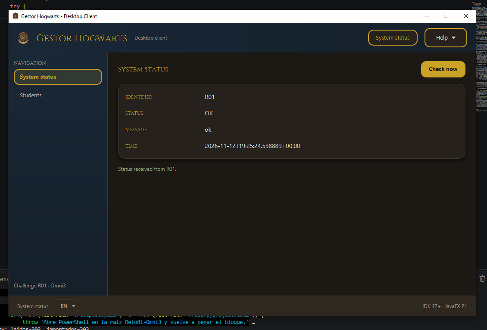

### Alumnado en JavaFX

Con All sources seleccionado, la tabla muestra 985 alumnos. La primera fila corresponde a Aamir Loonat (`10000000Z`), de Gryffindor, con el Patronus Mastiff y origen Derby.

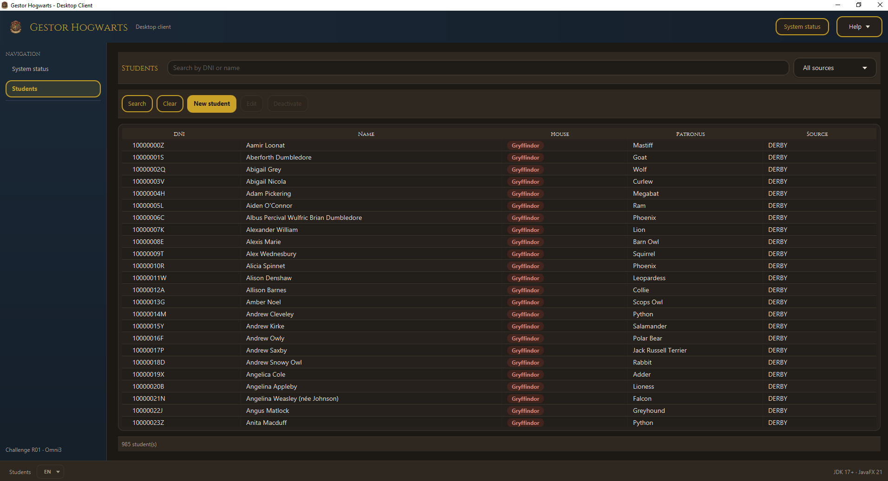

### Alumnado en Android

A las 20:07 la aplicación muestra 986 alumnos cargados e indica un 100 % de coincidencia entre el servidor y su caché SQLite. La primera fila muestra el mismo DNI y nombre de Aamir que JavaFX. El total corresponde a la consulta de cada captura.

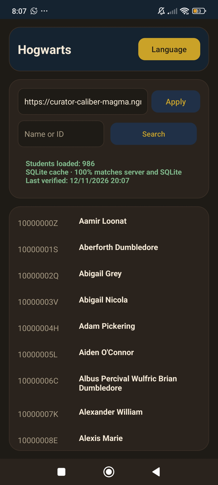

### Búsqueda por nombre en Unity

La búsqueda `luna` devuelve una alumna. La ficha muestra a Luna Scamander (née Lovegood), de Ravenclaw, con el Patronus Hare y su imagen. El campo de la API contiene `https://curator-caliber-magma.ngrok-free.dev`.

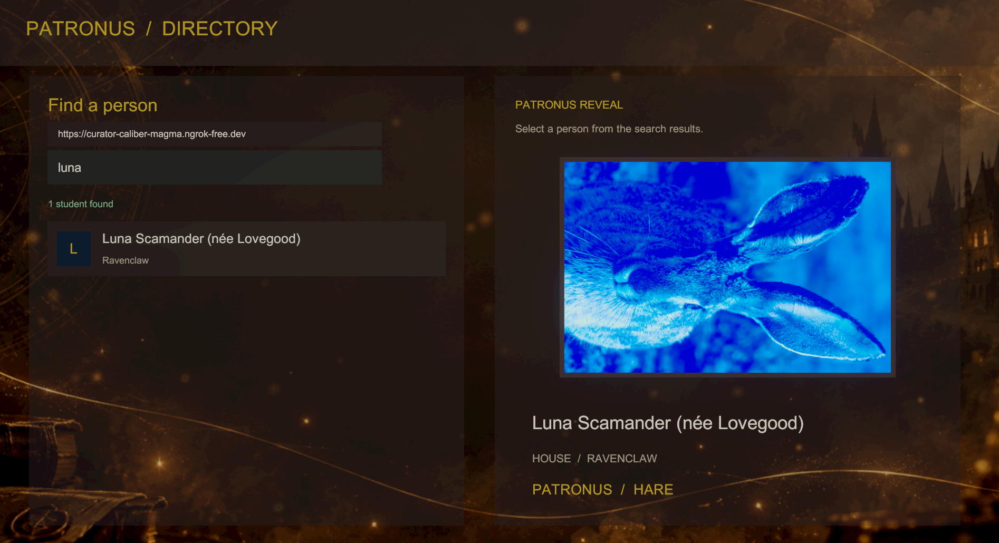

## Pruebas documentadas en octubre

| Aplicación | Dispositivo o entorno | Comprobación documentada | Fuente |
|---|---|---|---|
| Android | Redmi Note 11 | Prueba física en vertical y horizontal, sin recortes ni solapamientos, confirmada por el equipo. | [README Android](../gestorhogwartsmovil/README.md#validación-y-demostración-de-la-rúbrica). |
| Android | Redmi Pad SE | Prueba física en vertical y horizontal, sin recortes ni solapamientos, confirmada por el equipo. | [README Android](../gestorhogwartsmovil/README.md#validación-y-demostración-de-la-rúbrica). |
| Android | Dispositivo no identificado en el registro de ese caso | Consulta real de 985 alumnos; cierre y reapertura en modo avión con los 985 alumnos conservados en la caché SQLite. | [README Android](../gestorhogwartsmovil/README.md#validación-y-demostración-de-la-rúbrica). |
| Conjunto de aplicaciones | Dispositivos no detallados en la confirmación del 21/10/2026 | El equipo confirma pruebas manuales en dispositivos. No se asigna a esta confirmación una versión, plataforma o caso concreto adicional. | Confirmación del equipo incorporada en esta actualización documental. |

El README Android sitúa su bloque de validación en el 20/10/2026 y registra por
separado la comprobación del campo de URL del 21/10/2026. No identifica la versión
de Android ni el APK concreto de los dos dispositivos físicos; tampoco atribuye
el caso de los 985 alumnos a uno de ellos en particular.

## Comprobaciones automáticas de octubre

- **JavaFX:** 100 pruebas correctas, JAR generado y carga de cuatro vistas en tres
  idiomas. La carga FXML no incluyó una sesión gráfica interactiva. Véase la
  [revisión JavaFX](javafx-review.md).
- **Android:** el README registra compilación, 17 pruebas unitarias, lint y
  pruebas instrumentadas en emuladores; la comprobación más reciente del campo
  de URL tiene 9 pruebas instrumentadas correctas. Los emuladores no sustituyen
  las pruebas físicas de la tabla anterior.
- **API y Unity:** el [informe de integración](integration-audit.md) conserva el
  CRUD probado contra MariaDB y la importación batch de Unity.

## Datos para completar el registro

Al documentar una nueva prueba o recuperar el detalle de las ya realizadas,
registra estos datos junto al resultado:

| Dato | Contenido |
|---|---|
| Fecha y responsable | Día de la prueba y persona que la realizó. |
| Aplicación y versión | Componente, commit o etiqueta de release y nombre del artefacto. |
| Dispositivo | Modelo, sistema operativo y versión; resolución o escala cuando corresponda. |
| Entorno | API utilizada y motores activos, sin contraseñas ni tokens. |
| Casos y resultado | Acciones realizadas, resultado esperado, resultado observado e incidencias. |
| Evidencias | Capturas, vídeo o registros revisados para retirar datos sensibles. |

El [guion de demo](https://github.com/dm2-ethazi/Reto01-Omni3/wiki/07-Demo-Funcional)
permite repetir el recorrido entre clientes. La comprobación de una release debe
identificar el artefacto utilizado; este registro no atribuye las pruebas previas a
una release específica sin esa información.

## Comprobación desde un clon nuevo · 12/11/2026

Se clonó `main` en `comprobacion-final` (commit `d39f014`) y se ejecutó el bloque completo del README para Windows. Se crearon el entorno Python y el JAR de JavaFX. El arranque reutilizó la configuración, los datos y la API local de la instalación compartida. Los cuatro orígenes sumaron 985 históricos ya existentes. JavaFX recibió el estado R01/OK y se cerró tras capturar su ventana.

El recorrido manual verificó los cuatro DNI conocidos en MariaDB y SQLite. La demo HTTP completó 18 comprobaciones y conservó el alumno de prueba con baja lógica. Pytest registró 55 pruebas aprobadas, 8 omitidas y un aviso. Esta ejecución cubre el arranque y la demo ordinaria. Las pruebas de caída y reinicio quedan fuera de esta ejecución.

La imagen de JavaFX captura la ventana abierta por este clon. Las demás imágenes muestran los registros de salida de esta ejecución.

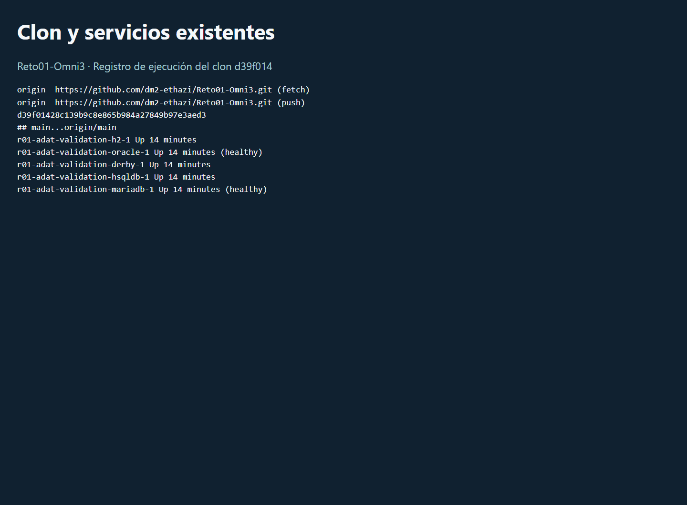

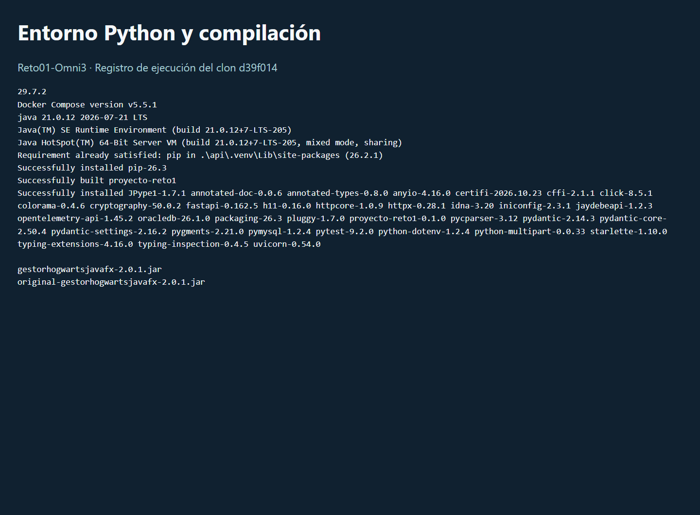

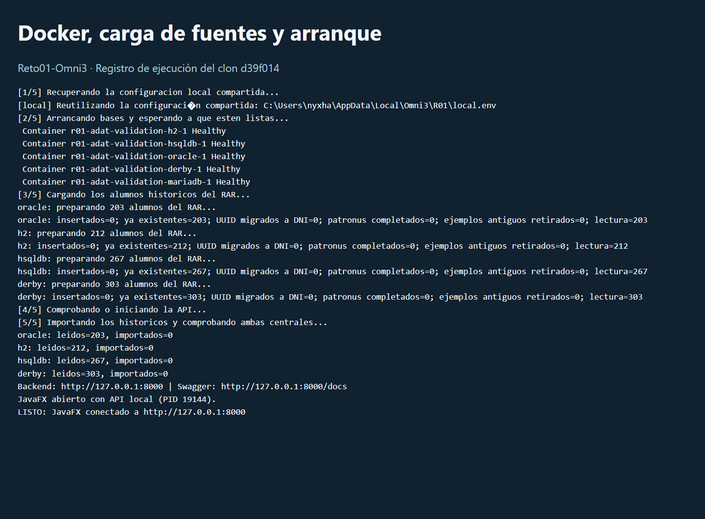

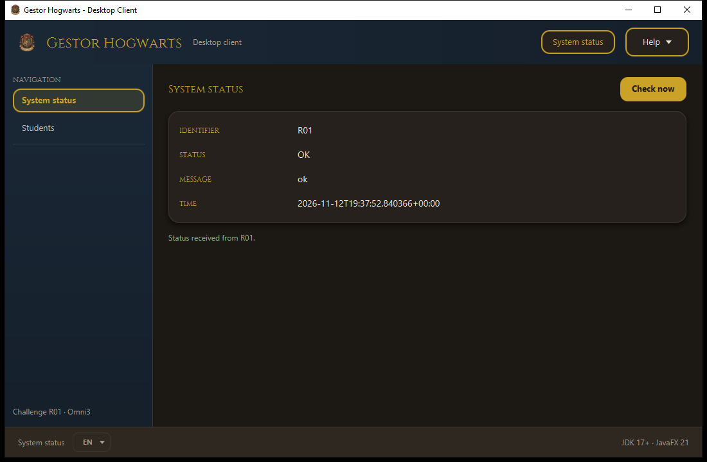

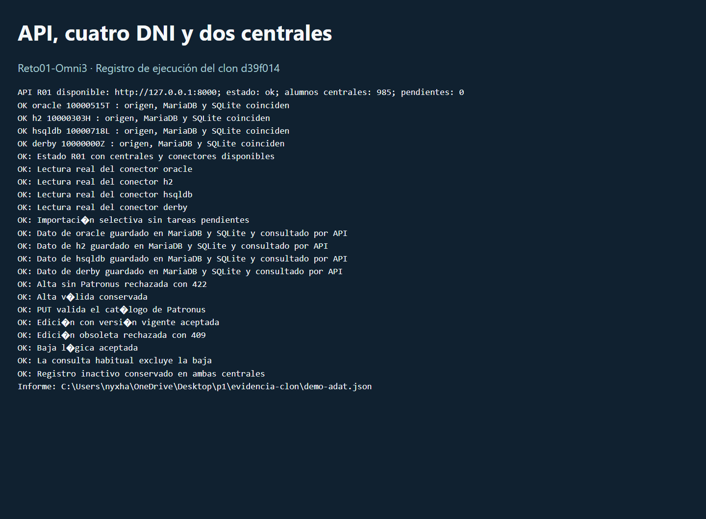

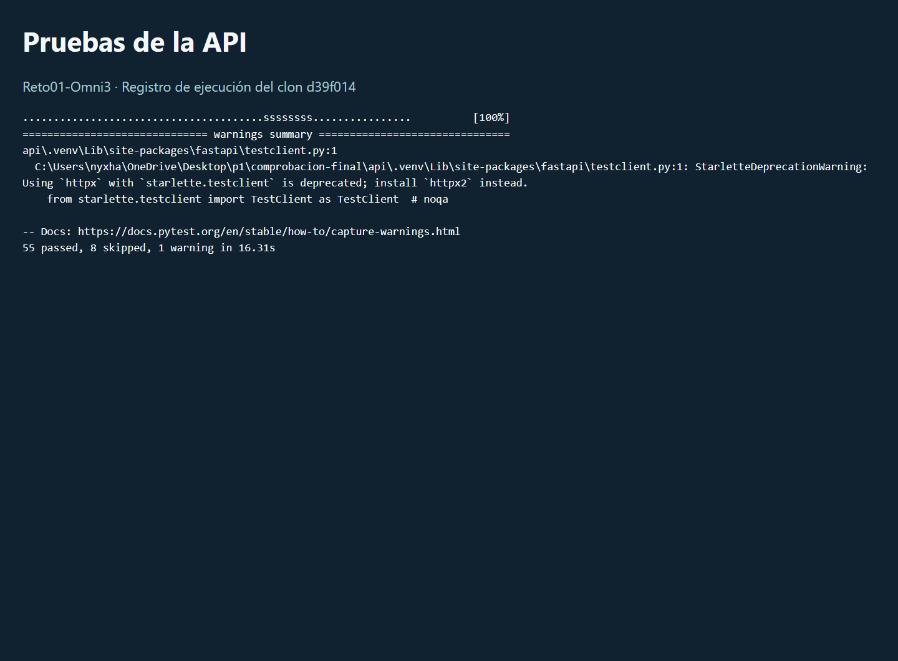

[Registros del clon](evidence/clon/01-clon.txt) · [Arranque completo](evidence/clon/02-arranque.txt) · [Salida de pytest](evidence/clon/03-pytest.txt) · [Salida de la demo](evidence/clon/04-demo.txt) · [Informe HTTP](evidence/clon/demo-adat.json)
