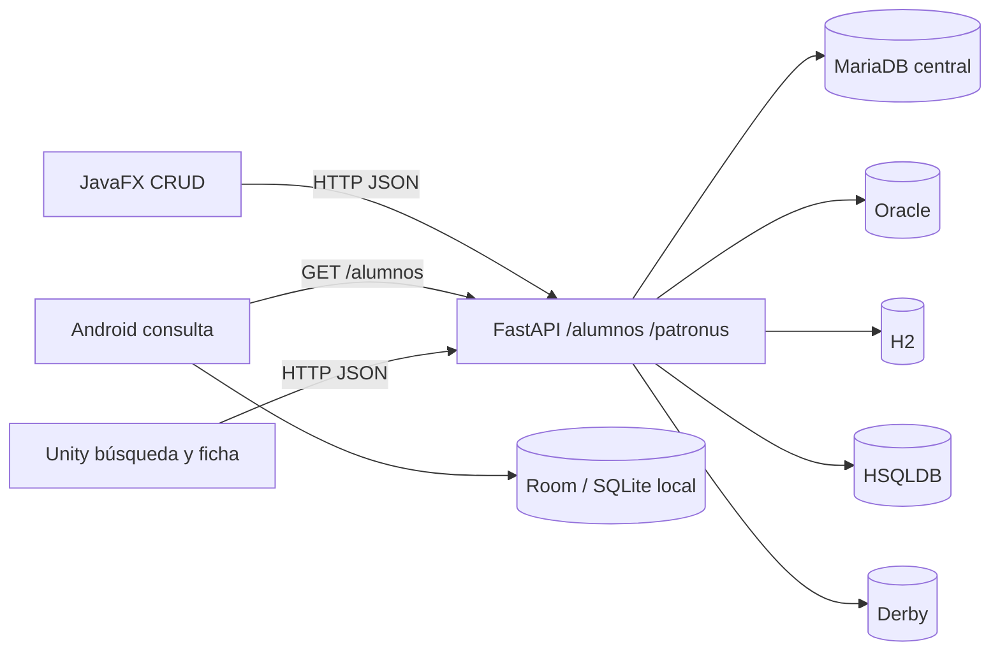

# Arquitectura del sistema

Las flechas a Oracle, H2, HSQLDB y Derby describen conexiones implementadas por las clases `api/src/proyecto_reto1/db/`. Su puesta en marcha completa sigue pendiente de esquemas y datos. `DB_ENGINES` permite activar solo MariaDB para el recorrido verificable.

## Responsabilidades y flujo

1. JavaFX (`ClienteAlumnosHttp`) consume GET/POST/PUT/DELETE y `/patronus`; carga la URL desde propiedad Java, variable de entorno o `config.properties`. Conserva la etiqueta de origen que entrega la API. En errores HTTP convierte la respuesta en `ExcepcionApi`.
2. Android (`ApiClient`) consume la colección completa. `StudentRepository` muestra primero la copia Room, consulta la API y reemplaza la copia solo tras comparar y verificar. Sin red conserva la copia anterior con estado de verificación distinto. No envía escrituras a la API.
3. Unity (`PatronusApiClient`) pide listados filtrados por nombre y fichas. La URL se edita en el campo **API URL** durante Play o en el componente de la escena. `PatronusDirectoryController` espera antes de buscar e ignora respuestas antiguas.
4. FastAPI (`api/alumnos.py`) inyecta los repositorios seleccionados por `db/factory.py`. Las lecturas agregan fuentes; POST escribe en MariaDB; PUT y DELETE recorren todas las fuentes donde exista un DNI. Si una fuente falla, responde 503. No hay transacción distribuida que garantice atomicidad entre motores.
5. MariaDB mantiene `ALUMNOS` y `PATRONUS_IMG`; H2/HSQLDB/Derby se conectan por JDBC con JVM; Oracle usa `oracledb`. El prototipo bajo `prototipo/` tiene su propio backend e infraestructura y no se lanza junto con esta API.

## Decisiones observables

El contrato común permite reutilizar clientes sin darles credenciales de base de datos. La caché SQLite responde al uso móvil sin conexión. Los cinco repositorios permiten comparar motores en el reto, a costa de configuración y consistencia más complejas. Las decisiones del equipo que no estén documentadas en código o README no se atribuyen a personas concretas.

| Decisión | Justificación técnica | Coste o límite |
|---|---|---|
| API REST con FastAPI y JSON | Un contrato para los tres clientes; validación Pydantic y documentación OpenAPI generada desde las rutas. | Los clientes necesitan red para obtener cambios del servidor. |
| Adaptador por motor y contrato `RepositorioAlumnos` | La capa HTTP utiliza las mismas operaciones sin depender del dialecto SQL de cada fuente. | Cada motor requiere configuración, esquema y pruebas propios. |
| Altas y catálogo centralizados en MariaDB | Un lugar definido para crear alumnado y resolver nombres e imágenes de patronus. | MariaDB es necesaria para estas operaciones aunque otras fuentes estén disponibles. |
| Room sobre SQLite en Android | Lectura local sin servidor SQLite separado; transacciones y verificación de la instantánea. | La copia puede estar desactualizada y no permite editar datos remotos sin red. |
| HTTP en los clientes | Las credenciales de base de datos se quedan en el backend. | Una exposición pública requiere añadir autenticación y TLS. |

Continuar: [modelo de datos](03-Modelo-de-Datos.md) · [backend](04-Backend.md).
