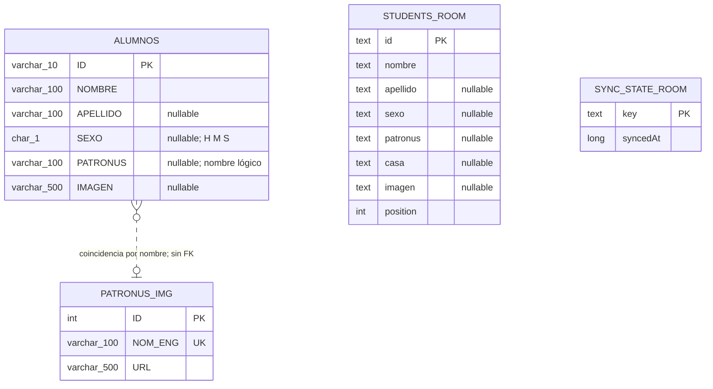

# Modelo de datos

Los modelos proceden de `api/src/proyecto_reto1/db/base.py`, las consultas de `db/mariadb.py` y la persistencia móvil de `gestorhogwartsmovil/.../data/StudentDatabase.kt`. El DDL versionado para el recorrido MariaDB está en `database/mariadb/01_schema.sql`.

`ALUMNOS.ID` es el DNI textual y clave primaria; `NOMBRE` es obligatorio. El API limita longitud y `SEXO` a `H`, `M` o `S`. `PATRONUS` guarda el nombre inglés y se valida contra `PATRONUS_IMG.NOM_ENG` **solo en POST**; el DDL no declara clave foránea. `PATRONUS_IMG.ID` es autoincremental, `NOM_ENG` único y `URL` texto. El catálogo de ejemplo contiene `Otter` con URL vacía, por lo que no demuestra la imagen.

En la respuesta, `casa` se calcula desde el repositorio que halló la fila y `patronus_url` se consulta en MariaDB; ninguno es columna de `ALUMNOS`. El esquema de los otros cuatro motores **debe** tener las seis columnas que selecciona la API; esta entrega no lo crea automáticamente.

Room guarda `students` con los campos remotos más `position` para mantener el orden. `sync_state` registra que una colección, incluso vacía, fue sincronizada y la fecha `syncedAt`. No hay clave foránea entre ambas tablas. La versión Room es 1; el esquema exportado está en `app/schemas/`. No se observan migraciones de versiones posteriores.

El prototipo usa `ESTUDIANTE` y un espejo SQLite propios; no se mezclan con estas tablas. Continuar: [persistencia](05-Persistencia-de-Datos.md).
