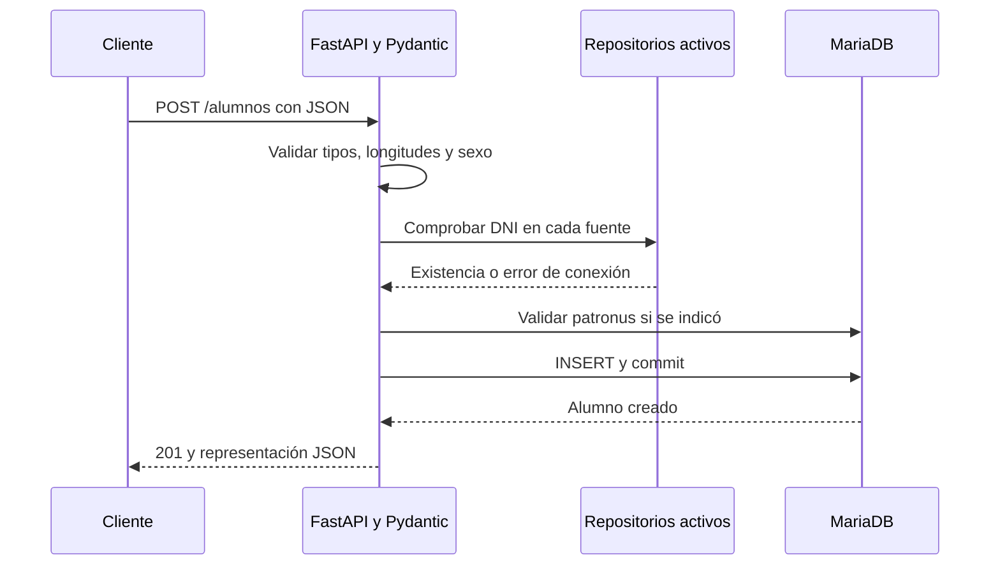

# Backend: API Alumnos

La aplicación principal es `api/src/proyecto_reto1/main.py` (FastAPI). `main_tareas.py` es una práctica independiente con lista en memoria; sus rutas `/tareas` no pertenecen al Gestor Hogwarts. La API principal no implementa `/health`: para comprobarla sin consultar bases se usa `/openapi.json`; para comprobar bases se usa `/alumnos`.

## Contrato HTTP implementado

| Método y ruta | Entrada y operación | Éxito | Errores relevantes |
|---|---|---|---|
| `GET /alumnos` | `nombre` opcional, prefijo 1–100 caracteres; agrega las fuentes activas. | 200, lista `Alumno[]` | 422 parámetro; 503 fuente fallida. |
| `GET /alumnos/{dni}` | Busca en orden de fuentes, primera coincidencia. | 200, `Alumno` | 404 inexistente; 503 fuente fallida. |
| `GET /patronus` | Consulta `PATRONUS_IMG` en MariaDB. | 200, lista `{nom_eng,url}` | 503 MariaDB ausente o fallida. |
| `POST /alumnos` | JSON `AlumnoEntrada`; DNI único global, patronus validado; inserta en MariaDB. | 201, `Alumno` | 409 duplicado; 422 datos/patronus; 503 fuente fallida. |
| `PUT /alumnos/{dni}` | JSON parcial con nombre, apellido, sexo, patronus o imagen; actualiza cada fuente donde exista. | 200, primer `Alumno` actualizado | 404 inexistente; 422 cuerpo/valores; 503 fuente fallida. |
| `DELETE /alumnos/{dni}` | Borra el DNI de cada fuente donde exista. | 204, sin cuerpo | 404 inexistente; 503 fuente fallida. |

`Alumno` devuelve `id`, `nombre`, `apellido`, `sexo`, `patronus`, `patronus_url`, `imagen` y `casa`. POST exige `id` (1–10) y `nombre` (1–100); el resto es opcional. `sexo` admite `H`, `M` o `S`. PUT no cambia `id`; el modelo rechaza `nombre: null` y cuerpos sin campos útiles. Los errores usan `detail` de FastAPI. No hay autenticación, autorización ni endpoints de métricas o auditoría en esta API.

## Ejemplos reproducibles

Con la [instalación MariaDB local](06-Ejecucion-del-Proyecto.md) y la API en `:8000`:

```bash
curl http://127.0.0.1:8000/openapi.json
curl http://127.0.0.1:8000/alumnos
curl 'http://127.0.0.1:8000/alumnos?nombre=Ada'
curl http://127.0.0.1:8000/patronus
curl -i -X POST http://127.0.0.1:8000/alumnos -H 'Content-Type: application/json' -d '{"id":"DEMO0001","nombre":"Ada","apellido":"Demo","sexo":"M","patronus":"Otter"}'
curl http://127.0.0.1:8000/alumnos/DEMO0001
curl -i -X PUT http://127.0.0.1:8000/alumnos/DEMO0001 -H 'Content-Type: application/json' -d '{"nombre":"Ada Editada"}'
curl -i -X DELETE http://127.0.0.1:8000/alumnos/DEMO0001
```

En PowerShell, usa `curl.exe` en lugar de `curl` para evitar alias de versiones antiguas. No repitas el POST con el mismo DNI sin borrarlo: responderá 409. Si `DB_ENGINES` contiene un motor sin esquema o no disponible, las lecturas responderán 503.

## Flujo y límites

`db/factory.py` crea repositorios por `DB_ENGINES`; `api/alumnos.py` contiene la lógica HTTP; los módulos `db/*.py` ejecutan SQL parametrizado. Los errores de conexión de las operaciones principales se registran y se transforman en 503, pero el detalle puede incluir el texto de la excepción original: se debe revisar antes de exponer la API. La consulta complementaria de `patronus_url` tiene otro tratamiento: si falla, registra un aviso y entrega la ficha con ese campo nulo. PUT/DELETE en varios motores no tienen transacción global; un fallo intermedio puede dejar una actualización parcial.



El diagrama representa el camino correcto. Un DNI existente termina con 409; un cuerpo inválido o un patronus desconocido, con 422; una fuente requerida inaccesible, con 503. En PUT, los campos omitidos se mantienen y las cadenas vacías de campos opcionales se normalizan a nulo; el nombre no admite nulo ni cadena vacía. El identificador es textual: no se comprueba una letra de control de DNI ni se exige un formato nacional.

## Gestión de eventos y métricas

Las operaciones de negocio se atienden durante la petición HTTP. No hay un bus de eventos, cola de mensajes ni tareas de procesamiento asíncrono en la API principal. `main_tareas.py` y el backend del prototipo son aplicaciones distintas y no aportan esas funciones a este servicio.

| Señal | Tratamiento implementado | Dónde observarla |
|---|---|---|
| Petición HTTP y código de respuesta | Registro de acceso de Uvicorn al ejecutarlo con su configuración predeterminada. | Terminal que ejecuta la API. |
| Fallo de consulta, escritura o validación del catálogo | `logging.getLogger(__name__)` y `logger.error`; normalmente termina en 503. | Salida de errores del proceso de la API. |
| Fallo al completar la URL del patronus | `logger.warning`; la ficha sigue disponible con `patronus_url=null`. | Salida de errores del proceso de la API. |
| Arranque, avisos y errores JavaFX | Clase `Registro`: consola y archivo `gestor-hogwarts.log` en el directorio de trabajo. | Consola y archivo local del cliente. |
| Fallo de persistencia o verificación Android | Registro Logcat con etiqueta `R01-PERSISTENCE`. | Logcat de Android Studio. |

La API no persiste una auditoría de altas, cambios y bajas; tampoco implementa contadores, histogramas de latencia, panel de métricas ni `/metrics`. JavaFX genera una cabecera `request-id`, pero el backend no la propaga ni la registra de forma correlacionada. La cantidad de alumnos y la fecha de verificación de Android describen datos y sincronización local, no una monitorización del servidor.

Para una comprobación manual de estado y duración desde Windows puede usarse:

```powershell
curl.exe -s -o NUL -w "HTTP %{http_code} | %{time_total} segundos\n" http://127.0.0.1:8000/alumnos
```

En Bash sustituye `curl.exe` por `curl` y `NUL` por `/dev/null`. Es una medición puntual desde el cliente; no se ha establecido un objetivo de rendimiento ni un resultado de carga. La evolución propuesta es registrar eventos estructurados con identificador de petición y medir peticiones, errores y latencia por ruta, según se recoge en [mejoras](08-Problemas-y-Mejoras.md).

Continuar: [persistencia](05-Persistencia-de-Datos.md) · [demo](07-Demo-Funcional.md).
