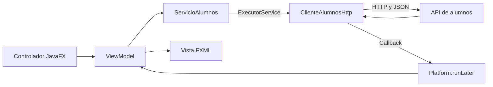

# Gestor Hogwarts — Cliente de escritorio (JavaFX)

Cliente de escritorio para **consultar, dar de alta, editar y dar de baja** alumnado
contra la API REST central del Reto R01 · Omni3, con pantalla de estado, catálogo de
patronus y tres idiomas.

> Requisitos de referencia: [`docs/00-contrato-tecnico.md`](docs/00-contrato-tecnico.md).
> Este README describe la implementación actual; las diferencias pendientes con esos
> requisitos y las comprobaciones del 21/10/2026 constan en la
> [revisión de JavaFX](../docs/javafx-review.md). Documentarlas no supone aprobar un cambio de alcance.

---

## 1. Título y descripción

**Título:** Gestor Hogwarts — Cliente de escritorio (JavaFX) · `com.omni3:gestorhogwartsjavafx:1.0.0`

La aplicación habla **por HTTP con la API configurada, local o remota**: no existe modo demo, ni
conmutador de datos, ni acceso directo a bases de datos (requisito del contrato §2–§3).
El único cliente es `api/ClienteAlumnosHttp` (`java.net.http.HttpClient` + Jackson).

| Pantalla | Qué hace |
|---|---|
| **Estado del sistema** | Comprueba la API real con `GET /alumnos` (estado, mensaje, momento y `request-id`). La API no publica `/health`. |
| **Alumnos** | Consulta unificada con **fuente de origen visible**, filtro por origen, búsqueda por DNI/nombre, alta, edición, baja y ficha. |

Reglas de negocio implementadas:

- **Alta** solo en la central MariaDB: DNI de 9 caracteres no duplicado, **patronus
  obligatorio** y **sin casa**.
- **Edición**: se lee la ficha vigente y se envía `PUT /alumnos/{dni}` con el nombre
  completo y el patronus; la fuente (`casa`) es de solo lectura porque la API no admite
  cambiarla.
- **Baja**: `DELETE /alumnos/{dni}` elimina físicamente el registro en las fuentes
  donde exista. No implementa la baja lógica de nuevos alumnos exigida en el contrato.
- Los mensajes de negocio que usan `enmascararDNI` ocultan parte del identificador
  (`12***78A`); la tabla y el formulario muestran el DNI completo. Las respuestas y
  trazas externas no tienen un filtro general de datos sensibles. Toda petición HTTP
  lleva cabecera **`request-id`**, que se conserva en los errores del cliente.
- **Tres idiomas** (castellano, euskera, inglés) con cambio en caliente desde la barra
  de estado (§9).

Endpoints que consume la API:

| Método | Ruta | Uso |
|---|---|---|
| `GET` | `/alumnos` | Listado unificado (búsqueda, filtro y paginación se aplican en el cliente) |
| `GET` | `/alumnos/{dni}` | Ficha de un alumno |
| `POST` | `/alumnos` | Alta (cuerpo `{id, nombre, apellido?, sexo?, patronus?}`) |
| `PUT` | `/alumnos/{dni}` | Edición (cuerpo `{nombre, apellido?, patronus?}`) |
| `DELETE` | `/alumnos/{dni}` | Baja (`204`; `404` si no existe) |
| `GET` | `/patronus` | Catálogo de patronus para el formulario |

Los errores se aceptan en los dos formatos del backend
(`{"error":{codigo,mensaje,detalle}}` o `{"detail":"…"}`); cualquier respuesta `>= 400`
se convierte en `ExcepcionApi` (código, mensaje, `request-id`, estado HTTP).
La edición ofrece recarga ante un `409`, pero el backend actual no comprueba
versiones ni produce conflictos de concurrencia reales. El `409` de alta indica DNI duplicado.

---

## 2. Requisitos previos

| Componente | Versión | Notas |
|---|---|---|
| Sistema | Windows 10/11 x86-64 de referencia | Revisión del 21/10/2026 en Windows 11. Hay perfiles Linux y macOS, sin verificar su ejecución en esta revisión. |
| Java | **JDK 17 o superior** (`maven.compiler.release=17`) | Revisión del 21/10/2026 con Oracle JDK 25.0.2; la integración anterior documenta JDK 21. |
| Maven | **3.9 o superior** | Instalación externa o Maven del IDE; no se incluye Maven ni wrapper en este módulo. Verificado con 3.9.16. |
| JavaFX | **21** (usa `21.0.5`) | **No hay que instalarlo a mano**: lo descarga Maven Central. |
| Memoria | 8 GB (16 GB recomendados) | §1 del contrato. |
| Red | Internet en el primer build | Para bajar dependencias de Maven Central. |
| API | Accesible por HTTP | Por defecto `http://127.0.0.1:8000`; se configura en §4. |
| Docker (opcional) | Cualquier versión con daemon activo | Solo para el contenedor de §5. |

---

## 3. Instalación de todo lo necesario

1. **JDK 17 o superior.** Instala [Eclipse Temurin](https://adoptium.net/) (u otra
   distribución) y comprueba:

   ```bash
   java -version    # debe informar de 17 o superior
   ```

2. **Maven.** Instala Maven 3.9+ y añade su carpeta `bin` al `PATH`, o configura
   el Maven incluido en tu IDE. Comprueba:

   ```powershell
   mvn -version
   ```

   No hay carpeta `tools/apache-maven-...` en la entrega actual.

3. **Clonar el repositorio:**

   ```bash
   git clone --branch main https://github.com/dm2-ethazi/Reto01-Omni3.git
   cd Reto01-Omni3/gestorhogwartsjavafx
   ```

4. **Primer build** (descarga dependencias y empaqueta; `EXIT=0` es obligatorio):

   ```bash
   mvn clean package
   ```

5. **Ejecutar las pruebas** (§6): `mvn test` → **100 pruebas, 0 fallos**.

6. **Configurar la URL de la API** (§4): copia la plantilla:

   ```bash
   cp config.properties.example config.properties   # Windows: copy config.properties.example config.properties
   ```

   y rellena `api.url`. Si no lo haces, la aplicación muestra un aviso traducido y
   continúa con la API local (§4 y §11).

7. **Opcional — IDE:** abre la carpeta del módulo como proyecto Maven (IntelliJ IDEA,
   VS Code + Extension Pack for Java, Eclipse). Compila y lanza desde la terminal o el
   panel Maven con `javafx:run` (§5): es la forma que Maven resuelve JavaFX por ti.

8. **Opcional — contenedor:** Docker solo para el build de §5e; la ventana corre en un
   X virtual (Xvfb).

---

## 4. Configuración de la API

La URL de despliegue **no se edita desde la ventana**: la resuelve
`util/ConfigLoader` siguiendo este orden (**primero que encuentre, gana**):

| # | Fuente | Detalle |
|---|---|---|
| 1 | Propiedad de sistema `-Dgestor.api.url` | La que usan las pruebas y los lanzamientos puntuales. |
| 2 | Variable de entorno `GESTOR_API_URL` | Cómoda para despliegues y contenedores. |
| 3 | `config.properties` en el **directorio de trabajo** | Clave `api.url`; es donde estés al lanzar. |
| 4 | `config.properties` **junto al JAR** | Clave `api.url`; válida al hacer `java -jar` desde otro directorio. |
| 5 | `config.properties` en el **classpath** | Uso puntual desde el IDE o pruebas. |

Plantilla versionada (`config.properties.example`):

```properties
# Copia la plantilla versionada a config.properties y escribe allí tu URL.
# config.properties es local y está en .gitignore.
api.url=https://tu-api-aqui.com
```

La plantilla se versiona; el fichero local `config.properties` que creas a partir de
ella queda ignorado por Git. El código conserva la URL local de respaldo indicada abajo.

Para desarrollo local con la API del propio equipo:

```properties
api.url=http://127.0.0.1:8000
```

Normalización aplicada al valor (en `ConfigApi`): se recortan espacios, se quitan las
`/` finales, se antepone `http://` si no traes esquema (puedes escribir solo
`127.0.0.1:8000`) y, si la URI queda inválida, se rechaza con un mensaje de error.

**Si ninguna fuente aporta la URL** se lanza `ExcepcionConfiguracion`; la aplicación
**no se cierra**: muestra el aviso «No se pudo cargar la configuración de la API» con
instrucciones traducidas, registra el error en `gestor-hogwarts.log` y continúa con la
API local `http://127.0.0.1:8000`. El timeout de peticiones es de 10 segundos.

Comprobación rápida de que la API responde (antes de arrancar la app):

```bash
curl http://127.0.0.1:8000/alumnos
# si está tras ngrok, añade la cabecera que el cliente envía siempre:
curl -H "ngrok-skip-browser-warning: 1" https://tu-api-aqui.com/alumnos
```

---

## 5. Todas las formas de ejecutar el programa

### a) En desarrollo, directo con Maven (lo más habitual)

```bash
mvn clean javafx:run
```

Compila y abre la ventana; no necesita build previo.
Este lanzamiento interactivo no se ha repetido en la revisión del 21/10/2026.

### b) Fat JAR (recomendado para distribuir)

```bash
mvn clean package
java -jar target/gestorhogwartsjavafx-1.0.0.jar
```

El JAR final lleva dentro las dependencias JavaFX, los FXML/CSS, las fuentes, los
iconos y los bundles i18n; su `Main-Class` es `com.omni3.gestorhogwartsjavafx.Launcher`
(una lanzadera que no extiende `Application`, requisito para poder hacer `java -jar`).
Incluye los binarios nativos de JavaFX de la plataforma elegida al compilar: el JAR
generado en Windows no es una entrega universal para Linux y macOS. El destinatario
necesita Java 17+ y una compilación para su sistema; el JAR no incorpora un JRE.
El empaquetado, el manifiesto y la carga de las cuatro vistas desde ese JAR están
comprobados. El equipo confirma pruebas manuales en dispositivos; no ha especificado si se hicieron mediante este JAR o mediante otro lanzamiento.

### c) Scripts de lanzamiento

Tras hacer `mvn clean package` (§b):

- **Windows:** `run.bat`
- **Linux/macOS:** `sh run.sh`

Se ejecutan desde la carpeta del módulo (usan la ruta relativa `target/…`).

### d) Con configuración o idioma forzados

```bash
# URL de la API por propiedad de sistema (gana sobre todo lo demás)
java -Dgestor.api.url=https://tu-api-aqui.com -jar target/gestorhogwartsjavafx-1.0.0.jar

# por variable de entorno (PowerShell)
$env:GESTOR_API_URL="https://tu-api-aqui.com"; java -jar target/gestorhogwartsjavafx-1.0.0.jar

# por variable de entorno (Linux/macOS)
GESTOR_API_URL=https://tu-api-aqui.com java -jar target/gestorhogwartsjavafx-1.0.0.jar

# idioma inicial forzado (si no, sigue al del sistema: es, eu, en o inglés por defecto)
java -Dgestor.idioma=eu -jar target/gestorhogwartsjavafx-1.0.0.jar
```

### e) En contenedor Docker

```bash
# desde la raíz del repositorio
docker build -f gestorhogwartsjavafx/Dockerfile -t gestorhogwarts-javafx gestorhogwartsjavafx
docker run --rm gestorhogwarts-javafx
```

El build usa `maven:3.9-eclipse-temurin-17` y la imagen final
`eclipse-temurin:17-jre-jammy` con Xvfb: la ventana se pinta en un X virtual, así que
el contenedor está preparado para iniciar sin servidor gráfico del anfitrión.
Su comando de inicio usa una pantalla virtual; no ofrece una ventana visible ni
acceso remoto a ella. Para mostrarla en un servidor X11 externo habría que configurar
el display y sustituir el comando `xvfb-run` del contenedor. Para uso interactivo
local, utiliza el JAR de tu plataforma. Para inyectar la URL de una API accesible
desde el contenedor:
`docker run --rm -e GESTOR_API_URL=https://tu-api-aqui.com gestorhogwarts-javafx`
(o monta un `config.properties` con `-v`).

> **Pendiente de verificación:** en la revisión del 21/10/2026 no se han ejecutado
> `docker build` ni `docker run`. La presencia del Dockerfile no acredita un despliegue
> probado ni una interfaz visible desde el equipo anfitrión.

### f) Sin API levantada

El cliente contempla el fallo de conexión y lo presenta con un `request-id`.
Las pruebas HTTP comprueban conexión rechazada y timeout. La revisión actual no
incluye una sesión manual de arranque sin API.

---

## 6. Comandos Maven útiles

Ejecuta los comandos desde la carpeta `gestorhogwartsjavafx/` con Maven disponible.
El resultado de la revisión del 21/10/2026 se distingue de los comandos de uso:

| Comando | Función y estado de comprobación |
|---|---|
| `mvn verify` | **Correcto:** compila, ejecuta 100 pruebas sin fallos ni errores y genera el fat JAR. No se hizo `clean` en esta ejecución. |
| `mvn clean package` | Comando para regenerar la entrega desde cero; no repetido por separado en esta revisión. |
| `mvn test` | Surefire fija `gestor.idioma=es`; sus 100 pruebas se ejecutaron dentro de `verify`. |
| `mvn clean javafx:run` | Lanzamiento interactivo en desarrollo; no repetido en esta revisión. |
| `mvn dependency:resolve` | Resolución explícita de dependencias; no repetida por separado. |
| `mvn javadoc:javadoc` | **Correcto:** genera `target/reports/apidocs/index.html`. |
| `mvn site` | Genera `target/site/index.html` y termina con `BUILD SUCCESS`, pero omite el informe `dependency-info` por un `LinkageError` entre plugins. Pendiente de corregir en el POM. |
| `mvn clean` | Limpia artefactos generados en `target/`. |

- **Perfiles de plataforma** (se activan solos según el SO; se pueden forzar con
  `-P`): `win`, `linux`, `mac`, `mac-aarch64`. Sirven para empaquetar los binarios
  JavaFX de otro sistema desde esta máquina.
- Las 100 pruebas JUnit se distribuyen en 12 clases y **no arrancan el toolkit JavaFX**.
  Cubren el doble de cliente, DTOs, validaciones, servicio, fábrica, configuración,
  idiomas, catálogo y viewmodels. `ClienteAlumnosHttpTest` usa sockets locales para
  comprobar fallos de red; el conjunto no certifica CRUD contra la API real.
- Si Maven no está en el `PATH`, configura su instalación o utiliza su ruta real.
  Ejemplo PowerShell con una ruta que debes sustituir por la de tu equipo:

  ```powershell
  & 'C:\RUTA_A_MAVEN\bin\mvn.cmd' -f '.\pom.xml' verify
  ```

---

## 7. Estructura del proyecto justificada

```
gestorhogwartsjavafx/
├── pom.xml                      build: perfiles multiSO, shade (fat JAR), surefire
├── README.md                    este documento
├── docs/00-contrato-tecnico.md  requisitos de referencia y diferencias actuales
├── config.properties.example    plantilla versionada (la real va en .gitignore)
├── Dockerfile · run.bat · run.sh despliegue y lanzamiento rápido
└── src/
    ├── main/java/com/omni3/gestorhogwartsjavafx/
    │   ├── App.java             ventana, escena y arranque
    │   ├── Launcher.java        lanzadera para `java -jar` (no extiende Application)
    │   ├── modelo/              Alumno, Origen, TipoAlumno, CatalogoPatronus
    │   ├── util/                Validaciones, ResultadoValidacion, Idiomas,
    │   │                        ConfigLoader, ExcepcionConfiguracion, Registro
    │   ├── api/                 ClienteAlumnos (interfaz), ClienteAlumnosHttp,
    │   │                        ConfigApi, ExcepcionApi, dto/
    │   ├── servicio/            ServicioAlumnos (hilos de fondo), FabricaAplicacion
    │   ├── viewmodel/           Consulta, Alta, Edición, Baja, Salud, Formulario…
    │   └── controlador/         controladores de cada pantalla + ControladorVista
    ├── main/resources/
    │   ├── com/omni3/gestorhogwartsjavafx/
    │   │   ├── vista/fxml/      principal, estado, alumnos, formulario-alumno (sin Java)
    │   │   ├── vista/css/tema.css   sistema de diseño «dark academia»
    │   │   ├── fonts/ icons/    Cinzel y Cormorant Garamond; icon-16…512
    │   └── i18n/                messages{_es,_eu,_en}.properties (§9)
    └── test/java/…              espejo de los paquetes + ClienteAlumnosFalso (solo tests)
```

**Por qué así:**

- **Organización actual:** vistas FXML/CSS en `vista/`, controladores Java en
  `controlador/` y paquetes separados por responsabilidad. Las diferencias con las
  rutas y vistas previstas inicialmente constan en el contrato anotado.
- **Separación por responsabilidades:** `controlador` → `viewmodel` (propiedades observables) →
  `servicio` → `api` → la respuesta vuelve con
  `Platform.runLater` al viewmodel y de ahí a la vista. Las operaciones de la API
  se despachan en un `ExecutorService` para no ejecutarlas en el hilo de interfaz.
- **Una sola puerta a la API:** la interfaz `ClienteAlumnos` con una única
  implementación HTTP (`ClienteAlumnosHttp`); el doble `ClienteAlumnosFalso` vive en
  `src/test` y **no se empaqueta**.
- **`util/`** agrupa lo transversal y testeable: reglas de validación, resolución de
  idioma, carga de configuración, excepción de configuración y registro de eventos.
- **`i18n/` en `resources`** para que los bundles viajen dentro del JAR (§10).
- **`config.properties` fuera de `src/`**: así Maven no lo copia a `target/` ni al
  JAR (§10).

Flujo de una petición:



---

## 8. Decisiones de diseño y tecnologías

| Tecnología | Versión | Por qué se eligió |
|---|---|---|
| JavaFX | 21.0.5 (`controls`, `fxml`, `graphics`, `base`) | Requisito del contrato §1; FXML declara la vista sin lógica. |
| Java | release 17 (verificado con JDK 25) | Compatibilidad mínima exigida; ninguna dependencia pide otra versión. |
| Maven | 3.9+ con perfiles por SO | Sola compilación (contrato); perfiles para el clasificador JavaFX de cada plataforma. |
| Jackson | 2.18.11 | Serializa los DTO JSON del backend sin traer un servidor ni javax. |
| `java.net.http.HttpClient` | incluido en el JDK | Cliente HTTP moderno y suficiente (timeouts, HTTP/2); cero dependencias extra. |
| `maven-shade-plugin` | 3.5.1 | Fat JAR con `Main-Class=Launcher`; Launcher evita el error «JavaFX runtime components are missing» de hacer `java -jar` sobre `Application`. |
| `javafx-maven-plugin` | 0.0.8 | `mvn javafx:run` en desarrollo. |
| JUnit Jupiter | 5.10.3 | Pruebas sin arrancar JavaFX; incluyen doble del cliente y comprobaciones HTTP con sockets locales. |
| Sin module-info | classpath | Empaquetado simple y compatible con shade; el aviso «unnamed module» al lanzar es cosmético (§11). |
| `util/Registro` propio | fichero `gestor-hogwarts.log` | Registro UTF-8 en apéndice sin añadir log4j/slf4j; cero dependencias. |
| Bundles `ResourceBundle` | 4 ficheros | i18n estándar del JDK, sin frameworks; `config.properties` aparte (§10). |

- **Patrón MVVM:** los viewmodels exponen `Property` de JavaFX; la vista solo traduce
  estado visible. Nunca hay lógica de negocio ni red en los FXML.
- **Sistema de diseño «dark academia»:** clases semánticas en `tema.css` y
  tipografías Cinzel/Cormorant incluidas en el JAR. Difiere de la paleta «azul tenue»
  del contrato. Hay un color literal en `ControladorVista` para el fondo de diálogos;
  no se ha medido el contraste AA en esta revisión.
- **Configuración externa:** la URL de despliegue se configura sin recompilar (§4).
  El código conserva `http://127.0.0.1:8000` como respaldo local.
- **Registro propio:** escribe `info`, `aviso` y `error` en fichero y consola (§9).
  No dispone de nivel debug ni de auditoría completa de operaciones CRUD.

**Límites de la implementación y diferencias pendientes con el contrato:**

- La fuente (`casa`) no es editable: la API identifica la base con la que responde.
- El backend no versiona: el DTO HTTP usa `version = 0` y el modelo la normaliza a 1;
  ninguno de esos valores acredita control de concurrencia. PUT no envía el estado previo.
- La baja es física, también en MariaDB. El campo `activo` del modelo no implementa
  borrado lógico en el backend.
- La pantalla Estado consulta `/alumnos`; no hay `/health`, conectores ni
  sincronización en este cliente y su API principal.
- `GET /alumnos` devuelve el listado completo: filtro, búsqueda y paginación se aplican
  en el cliente.
- Autenticación y nube figuran fuera de alcance en el contrato de referencia.
  Las otras diferencias requieren implementación o una modificación de requisitos
  expresamente aprobada; no se ha encontrado esa aprobación en la documentación revisada.

---

## 9. Internacionalización, logs y accesibilidad

### Internacionalización

- **Cuatro bundles** en `src/main/resources/i18n/`:
  `messages.properties` (base **inglesa**, red de seguridad), `messages_es.properties`,
  `messages_eu.properties` y `messages_en.properties`; **150 claves con los mismos
  nombres** en los cuatro ficheros, comprobadas el 21/10/2026.
- En **FXML** los textos traducibles son `%clave` (`text="%boton.buscar"`); en **Java**,
  `Idiomas.texto("clave", …)` (con `MessageFormat` para los parámetros).
- **Idioma inicial:** sigue al del sistema cuando es `es`, `eu` o `en`; cualquier otro
  locale cae a inglés. Se fuerza con `-Dgestor.idioma=es|eu|en` (lo usan las pruebas).
- **Cambio en caliente** con el desplegable de la barra de estado (`ES`/`EU`/`EN`):
  reconstruye la raíz y restaura la pantalla visible. No se ha verificado conservar
  búsquedas, selección o formularios sin guardar; termina las ediciones antes de cambiar.
- La revisión cargó las cuatro vistas en cada uno de los tres idiomas desde el JAR
  generado: 12 cargas correctas. No equivale a revisar visualmente todas las pantallas.
- Una clave ausente incluso en el bundle base puede producir
  `MissingResourceException` o un error de carga FXML: véase §11.

### Logs

- Fichero **`gestor-hogwarts.log`** (UTF-8, apéndice) en el directorio de trabajo;
  también se replica en consola. Si el disco no permite escribir, el aviso va a
  `System.err` y la app continúa.
- Puntos de registro (`util/Registro`): `aviso`, `info`, `error` (con traza de la
  excepción). Ejemplos de formato:

  ```text
  …INFO  URL de la API resuelta desde fichero config.properties
  …INFO  Aplicación iniciada
  …ERROR Configuración de la API ausente o inválida (ExcepcionConfiguracion); se continúa con la API local
  …ERROR Fallo de red al consultar la API (petición 22f5d0b0-…)
  ```

- `ConfigLoader` registra el **origen** de la configuración, sin escribir su valor.
  El cliente registra los fallos de red con `request-id`; no registra sistemáticamente
  consultas, altas, modificaciones, bajas correctas ni errores HTTP. No permite
  reconstruir toda la actividad. Las trazas se copian sin saneamiento general (§10).

### Pruebas manuales del equipo

El equipo confirma pruebas manuales en dispositivos. El [registro de validación manual](../docs/manual-validation.md) recoge la evidencia disponible, incluidas las pruebas físicas Android en Redmi Note 11 y Redmi Pad SE, y los datos que faltan para identificar las versiones y la cobertura de cada componente.
La lista siguiente describe los mecanismos de accesibilidad presentes y los puntos concretos aún por documentar o corregir.

### Accesibilidad

- **Tooltips** declarados en los FXML y añadidos a botones de diálogo desde los
  controladores. Comprobados en Buscar, Limpiar, Nuevo alumno, Editar y Dar de baja.
- **Mnemónicos y etiquetas:** hay `mnemonicParsing` y cuatro enlaces `labelFor` en el
  formulario. Los cinco botones anteriores no tienen marcador `_` en sus textos y
  carecen de mnemónico, aunque algunas acciones sí tienen atajo.
- **Campos con texto de ayuda** mediante `promptText`.
- **Atajos de teclado:** `Ctrl`/`⌘` + `N` (alumno nuevo), `Ctrl`/`⌘` + `F` (buscar) y
  `Ctrl`/`⌘` + `Supr` (baja), `Ctrl`/`⌘` + `1`/`2` (Estado/Alumnos) y `F1` (ayuda).
- **Dimensiones mínimas:** ventana principal de 640 × 480 y formulario de 480 × 460;
  los tamaños mínimos y los contenedores flexibles no sustituyen una prueba visual
  de redimensionado, escalado del sistema y navegación por teclado.
- El CSS define estilos de foco; falta documentar la comprobación específica y la
  medición de contraste antes de afirmar conformidad AA o presentación perfecta.

---

## 10. Seguridad

- **`config.properties` nunca viaja versionado ni empaquetado:**

  | Garantía | Dónde está |
  |---|---|
  | Ignorado por Git | `.gitignore` del módulo (`config.properties`) |
  | Fuera de los recursos copiados a `target/classes/` | `maven-resources-plugin` → `<excludes>` en `pom.xml` |
  | Fuera del fat JAR | filtro de `maven-shade-plugin` en `pom.xml` |
  | Fuera de la imagen | `.dockerignore` |
  | Plantilla versionada | `config.properties.example` (valor de ejemplo, sin secreto) |

  Se puede comprobar en cualquier momento (desde la carpeta del módulo):

  ```bash
  git check-ignore config.properties          # debe imprimir la ruta
  jar tf target/gestorhogwartsjavafx-1.0.0.jar | findstr config.properties   # Windows: sin salida
  # Linux/macOS: jar tf target/gestorhogwartsjavafx-1.0.0.jar | grep config.properties
  ```

- **La URL real no aparece en el código:** la única URL escrita en Java es la local de
  desarrollo `http://127.0.0.1:8000` (`ConfigApi.URL_POR_DEFECTO`), usada por
  `porDefecto()` y por el aviso de respaldo.
- **Límite del tratamiento de mensajes:** el aviso inicial evita imprimir el valor
  configurado y el registro de carga anota su origen. Los mensajes de fallo de red sí
  incluyen la URL base; algunas respuestas y trazas conservan el detalle original.
  No se deben introducir credenciales en la URL ni afirmar que existe un filtro
  general de secretos o DNI. El backend no registra ni propaga el `request-id` del cliente.
- **Cabeceras:** el cliente envía `ngrok-skip-browser-warning` (cabecera pública de
  ngrok, sin credenciales) para que el túnel no interponga su página de aviso.
- **Sin autenticación:** fuera de alcance según el contrato; no hay usuarios, tokens ni
  claves en el cliente.
- **Comprobación del 21/10/2026:** el JAR generado no contiene `config.properties` ni
  `ClienteAlumnosFalso`. No se encontraron credenciales reales en el módulo revisado;
  esto no equivale a auditar todo el repositorio y su historial.
- **Recomendaciones operativas:** mantén `config.properties` fuera de Git. Ante una
  filtración confirmada, revoca o rota primero las credenciales y coordina la retirada
  del contenido y, si procede, del historial con el equipo.
  La API documenta su propia configuración secreta (`.env`) en el
  [README de la raíz](../README.md).

---

## 11. Solución de problemas frecuentes

| Síntoma | Causa probable | Solución |
|---|---|---|
| Aviso **«No se pudo cargar la configuración de la API»** al arrancar | No hay `config.properties` ni variables | Copia `config.properties.example` a `config.properties` junto al JAR o en el directorio de trabajo y rellena `api.url` (§4). La app sigue abierta con la API local. |
| **«No se pudo contactar con la API en http://127.0.0.1:8000 (conexión rechazada)»** | La API no está levantada o la URL es otra | Levanta la API y comprueba `curl http://127.0.0.1:8000/alumnos`. Si cambia la URL, modifica `api.url` (§4) y reinicia el cliente para recargar la configuración. |
| `MissingResourceException` o error al cargar textos FXML | Falta una clave incluso en el bundle base | Añade la clave a los cuatro ficheros de `src/main/resources/i18n/` con sus traducciones y vuelve a compilar. |
| Error al cargar un FXML («Controller … not found», campo nulo) | Ruta o `fx:id` desalineados | Las vistas se cargan desde `ControladorVista.RUTA_VISTAS` = `/com/omni3/gestorhogwartsjavafx/vista/fxml/`; `fx:id` y `fx:controller` deben coincidir con el controlador. |
| **«JavaFX runtime components are missing»** | Se lanzó `App` con un classpath incompleto | Usa `mvn javafx:run` o el fat JAR (su `Main-Class` es `Launcher`, §5). |
| `Unsupported JavaFX configuration: classes were loaded from 'unnamed module'` | Aviso de JavaFX con classpath (sin module-info) | Cosmético e inofensivo; documentado como decisión en §8. |
| `WARNING: … System::load … / Restricted methods` | Java moderno avisa sobre acceso nativo | La carga FXML pasó con JDK 25.0.2 pese al aviso. Para ese JDK puede usarse `java --enable-native-access=ALL-UNNAMED -jar target/gestorhogwartsjavafx-1.0.0.jar`; no se garantiza el comportamiento de futuras versiones. |
| **`mvn` no se reconoce** | Maven no está en el `PATH` | Instala Maven 3.9+ y configura `PATH`, o usa la ruta real del Maven de tu IDE (§3 y §6). |
| `mvn site` termina pero omite `dependency-info` | Incompatibilidad entre el plugin de informes y Doxia (`Sink.verbatim()`) | El sitio se genera parcialmente. La corrección requiere ajustar versiones en `pom.xml`; sigue pendiente. |
| `java -version` informa de algo menor que 17 | JDK antiguo o `JAVA_HOME` mal apuntando | Instala Temurin 17+ (§2–§3) y reabre la terminal. |
| Fallan pruebas tras un cambio grande | Artefactos de `target/` desactualizados | `mvn clean test`. |
| El log `gestor-hogwarts.log` no aparece | El directorio de trabajo es de solo lectura | Lanza desde una carpeta con permisos de escritura; el error también va a consola. |
| Docker: build no probado o ventana invisible | Demonio apagado / Xvfb usa una pantalla virtual | Comprueba Docker y los comandos de §5e. El inicio actual no muestra una ventana en el anfitrión; usa el JAR para la ejecución interactiva local. |
| curl devuelve HTML en vez de JSON (túnel ngrok) | Página interstitial de ngrok-free | Añade `-H "ngrok-skip-browser-warning: 1"` (el cliente ya la envía siempre). |

---

## 12. Autores y licencia

- **Desarrollo principal del cliente:** [jairoben](https://github.com/jairoben) — Jairo Ben,
  identificado como desarrollador en `pom.xml`.
- **Equipo Omni3:** [henritejada2006](https://github.com/henritejada2006) y
  [koldoaso](https://github.com/koldoaso), junto a Jairo.
- **Repositorio de la organización:** <https://github.com/dm2-ethazi/Reto01-Omni3>.
  La entrega integrada está en `main`; `javafxapp` conserva la rama de origen del cliente.
- **Documentación relacionada:**
  [contrato técnico del cliente](docs/00-contrato-tecnico.md) ·
  [README de la API](../api/README.md) · [README general](../README.md) ·
  [revisión de JavaFX](../docs/javafx-review.md).

**Licencia:** el repositorio **no incluye fichero `LICENSE`**, así que no se declara
licencia formal: el código forma parte del Reto R01 · Omni3 y sus autores conservan
sus derechos. Si quieres reutilizarlo o distribuirlo, añade un fichero `LICENSE` a la
raíz o pide permiso a los autores.
