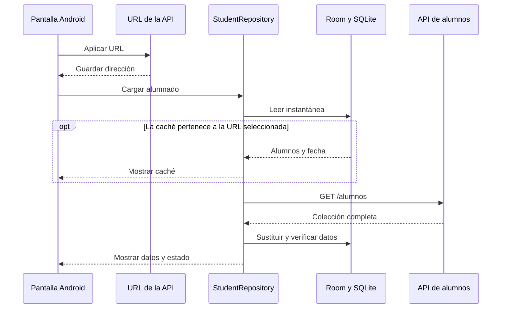

# Gestor Hogwarts Móvil

Aplicación Android en Kotlin para consultar alumnos por nombre o identificador,
abrir su ficha y trabajar sin conexión. Idiomas: inglés, castellano y euskera.
Layouts adaptados a teléfono y tablet, en vertical y horizontal.

## Estructura

Código en `app/src/main/java/com/omni3/gestorhogwartsmovil/`:

- `data/ApiClient.kt`: GET /alumnos, JSON, HTTP y timeouts.
- `data/ApiUrlSettings.kt`: URL editable, guardado local y asociación de la caché con su servidor.
- `data/StudentDatabase.kt`: SQLite mediante Room, entidades, DAO y transacciones.
- `data/StudentRepository.kt`: caché primero, verificación, sincronización y errores.
- `Student.kt` y `StudentResult.kt`: modelo, origen y estado de verificación.
- `MainActivity.kt`, `StudentAdapter.kt`, `StudentViewActivity.kt`: presentación.
- `WindowInsets.kt`: protección frente a barras del sistema y recortes de pantalla.

Las responsabilidades están separadas; el acceso a datos se puede probar mediante
inyección de una función remota, caché y reloj. El código propio incluye KDoc.

## Caché primero y verificación de persistencia



1. El repositorio lee SQLite antes de consultar la red.
2. Si hay una instantánea, incluso vacía, la muestra inmediatamente mediante un
   callback suspendido. La pantalla indica «Caché SQLite · Verificando».
3. Consulta la colección completa del servidor mediante GET /alumnos en IO.
4. Valida nombres e identificadores obligatorios y rechaza IDs duplicados.
5. Compara TODOS los campos, cantidad y orden con la instantánea local. Si el
   servidor ha cambiado, sustituye la colección completa y elimina filas ausentes.
6. Guarda filas y fecha de forma atómica. Relee SQLite dentro de la transacción:
   cualquier diferencia provoca rollback. El repositorio vuelve a leer tras
   guardar y exige igualdad exacta con la respuesta y fecha esperadas.
7. Solo tras esas comprobaciones muestra «verificado al 100%» y la fecha.
   Si ya coincidían, mantiene el origen SQLite; si hay cambios, indica Tiempo real.
8. Sin red o con errores del servidor conserva la caché y explica que no se ha
   podido verificar. Sin caché muestra un aviso con posibilidad de reintentar.
9. Si falla la persistencia, permite ver la respuesta remota con una advertencia;
   nunca anuncia una verificación correcta ni una nueva fecha persistida.

Una lista vacía es válida; la tabla sync_state distingue vacío sincronizado de
una instalación sin datos. Un Mutex serializa las cargas y escrituras. Las
cancelaciones se propagan al ciclo de vida; no se convierten en errores.

**replaceComplete solo admite colecciones completas y autoritativas.**
No debe usarse con respuestas filtradas, paginadas o individuales.

## Uso y feedback

- Buscar filtra por nombre completo o identificador exacto, sin distinguir
  mayúsculas. Un identificador inexistente muestra un aviso amable.
- Buscar con el campo vacío vuelve a leer la caché y verificar con la API.
- El campo **URL de la API** permite cambiar de servidor sin recompilar. **Aplicar** guarda la dirección y recarga la lista.
- Durante la verificación aparece una barra animada; se puede consultar la lista.
- Origen, verificación y última fecha permanecen visibles durante las búsquedas.
- Los errores no exponen excepciones, códigos HTTP ni mensajes técnicos.
- Los mensajes no se recortan a dos líneas y el panel horizontal permite scroll.
- Se respetan las barras del sistema; los estados se anuncian a accesibilidad.
- La ficha reutiliza los datos cargados. Si la foto falla, conserva el icono.
  Las imágenes no se persisten en SQLite.

## Configuración y ejecución

Abrir esta carpeta en Android Studio, sincronizar Gradle y elegir dispositivo.
Se requiere SDK 37 para compilar; la app admite Android 7.0/API 24 o superior.
El proyecto usa el wrapper incluido y el JDK de Android Studio.

La URL inicial de la API es `https://curator-caliber-magma.ngrok-free.dev` y
aparece escrita en el campo. Al vaciarlo, el hint muestra `http://10.0.2.2:8000`,
la dirección local para el emulador Android con la API en el equipo anfitrión.
El hint es solo una ayuda visual y no cambia la conexión. En la pantalla
principal se puede introducir una URL HTTP o HTTPS y pulsar **Aplicar** o
**Hecho** en el teclado.
La app recuerda esa elección al reiniciarse y la usa para las siguientes
peticiones. Para Redmi Note 11, Redmi Pad SE u otro dispositivo físico, utiliza
una dirección accesible desde la misma red.

También se puede definir la URL inicial al compilar, por ejemplo:

```powershell
./gradlew.bat :app:assembleDebug -Pomni3ApiUrl=http://192.168.1.20:8000
```

También se admite la variable de entorno `GESTOR_API_URL`. Arranca la API
escuchando en una interfaz de red alcanzable por el dispositivo y comprueba
que el cortafuegos permite el puerto 8000. La caché SQLite se presenta cuando
corresponde a la URL seleccionada. La cabecera `ngrok-skip-browser-warning`
se conserva para las pruebas que utilicen un túnel HTTPS.

La base sigue en versión 1 y conserva su identityHash original. El esquema
exportado se encuentra en app/schemas con el nuevo paquete de StudentDatabase.
No hay migraciones destructivas ni borrado de la caché al arrancar.

Los iconos adaptativos están limitados a API 26 y posteriores; Android 7.0 y
7.1 usan los iconos `.webp` de densidad. El tema aplica el atributo de barra de
navegación introducido en API 27 solo en esa versión y posteriores.

## Diagnóstico

Marca implementada: **R01-PERSISTENCE**, presente en el código de comprobación
y en Logcat cuando falla SQLite o su verificación.

## Validación y demostración de la rúbrica

Desde esta carpeta, con JDK configurado:

```powershell
./gradlew.bat :app:assembleDebug :app:testDebugUnitTest :app:lintDebug
./gradlew.bat :app:connectedDebugAndroidTest
```

Pruebas unitarias: orden caché/red, comparación de todos los campos, reconexión,
colecciones vacías, búsquedas, errores HTTP y de almacenamiento, relectura
inconsistente, cancelación y concurrencia.

Pruebas instrumentadas: SQLite real, cierre y reapertura, actualizaciones,
borrados, orden, rollback y verificación del repositorio al reabrir offline;
navegación, recreación de ficha y recursos de teléfono/tablet en ambas orientaciones.

Para demostrar los criterios máximos:

1. Abrir con red: observar carga y «Tiempo real · SQLite verificado al 100%».
2. Reiniciar con red: comprobar caché primero y coincidencia con el servidor.
3. Cerrar, desconectar y reabrir: comprobar lista, búsqueda y ficha desde SQLite.
4. Modificar un campo en el servidor, reconectar y buscar con el campo vacío:
   comprobar actualización, nueva verificación y conservación al reiniciar offline.
5. Buscar un identificador inexistente y comprobar el aviso, sin cierre.
6. Probar una instalación sin datos ni red y recuperar la conexión.
7. Revisar ambos idiomas adicionales, orientaciones, tablet y un dispositivo real.

La validación física se registra a continuación.

Validación realizada el 20/10/2026: assembleDebug, 17 pruebas unitarias y 8
instrumentadas en cada AVD (Small_Phone API 37 y Medium_Tablet API 35) correctos.
La compilación con `minSdk=24` generó un APK que declara API 24 como mínimo;
`assembleDebug`, las 17 pruebas unitarias y `lintDebug` terminaron correctamente.
Lint: 0 errores, 13 advertencias (compatibilidad de atributos, versiones y
detalles de layouts existentes).
En esta revisión también finalizaron las 8 pruebas instrumentadas en el AVD
Medium_Phone con Android API 37, sin fallos.
Prueba real de GET /alumnos: 985 alumnos verificados; cierre y reapertura en
modo avión conserva los 985 alumnos y muestra el origen Caché SQLite.

El equipo confirmó que la aplicación pasó la prueba física en Redmi Note 11
y Redmi Pad SE, en ambas orientaciones, sin recortes ni solapamientos.

Validación del campo de URL el 21/10/2026: APK, 17 pruebas unitarias y lint
correctos; 9 pruebas instrumentadas correctas en Medium_Phone con Android 37.
La pantalla principal se revisó en ese emulador en vertical y horizontal.
