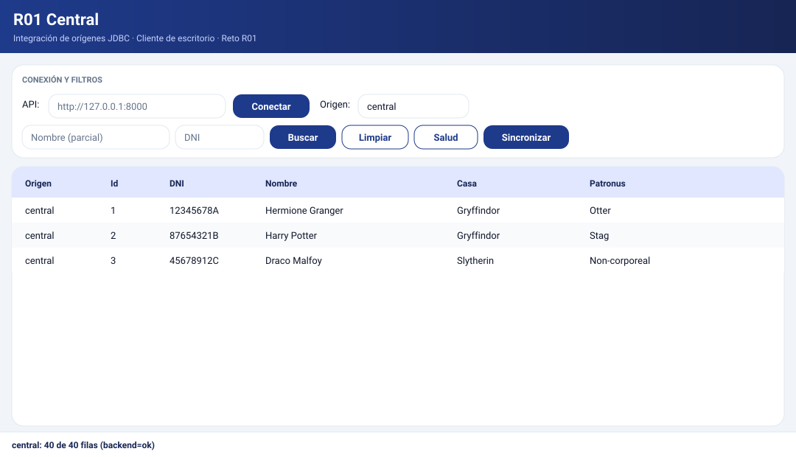

# R01 · Cliente de escritorio (JavaFX + MVVM)

> **Reto R01** · Cliente JavaFX con patrón MVVM puro · `es.r01.desktop`


## 🎨 Diseño

**Mock de referencia** (1080 × 620): [`docs/diseno-principal.svg`](docs/diseno-principal.svg)



| Decisión | Valor |
|----------|-------|
| **Paleta** | Primario `#1E3A8A` · Oscuro `#172554` · Acento `#06B6D4` · Fondo `#F1F5F9` · Superficie `#FFFFFF` · Borde `#E2E8F0` — idéntica a Android y Unity |
| **Tipografía** | Segoe UI / Inter / Roboto · 22px título · 14px cuerpo · 13px botones · 11–12px etiquetas |
| **Espaciado** | Rejilla de 8px: 8 / 10 / 12 / 14 / 16 / 18px |
| **Radios** | Tarjeta 16px · Campo y botón 12px |
| **Componentes** | Cabecera en degradado, tarjetas con sombra suave, botones primario/secundario con hover/pressed/disabled, tabla con cabecera `#E0E7FF` y filas alternas `#F8FAFC` |

**Hoja de estilos:** `src/main/resources/es/r01/desktop/vista/estilos.css`
(cargada desde `principal.fxml` con `stylesheets="@estilos.css"` y, en el
arranque por código, con `Scene.getStylesheets()`).

## 🗂️ Arquitectura (MVVM)

| Capa | Paquete | Papel |
|------|---------|-------|
| Vista | `es.r01.desktop.vista` + `resources/.../vista/*.fxml` | Sólo declara controles y enlaza |
| ViewModel | `es.r01.desktop.viewmodel` | Estado observable y acciones (CRUD incluido) |
| Servicio (Model) | `es.r01.desktop.servicio` | Hilo de fondo + callbacks, nunca bloquea el hilo FX |
| Cliente HTTP | `es.r01.desktop.api` | `java.net.http.HttpClient` + Jackson |
| Modelos | `es.r01.desktop.modelo` | `Estudiante`, `Pagina`, `EstudiantePayload`, `EstudianteUpdate` |

> Los `fx:id` de `principal.fxml` (`campoUrl`, `campoNombre`, `campoDni`,
> `comboOrigen`, `tabla`, `estado`, `botonBuscar`, `botonConectar`,
> `botonSincronizar`, `botonSalud`, `botonLimpiar`) son **contrato con
> `PrincipalController`** y no deben cambiarse. Las columnas de la tabla
> las crea el controlador con `PropertyValueFactory`.

## ▶️ Ejecución

```bash
mvn -f pom.xml javafx:run    # arranca es.r01.desktop.App

# o sólo compilar
tools\apache-maven-3.9.11\bin\mvn.cmd -f pom.xml test-compile -q   # EXIT=0
```

URL por defecto del backend: `http://127.0.0.1:8000` (editable en la barra superior).

## 🔌 Operaciones cubiertas (`CentralClient`)

- `GET /health`, `GET /connectors`, `GET /central/consistencia`
- `GET /central/estudiantes` y `GET /central/estudiantes/{dni}`
- `GET /connectors/{id}/estudiantes` (offset, limit, dni, nombre)
- `POST /connectors/{id}/estudiantes` (201) → `GET`/`PUT`/`DELETE` `.../estudiantes/{row_id}`
- `POST /sync`

## ⚙️ Requisitos del backend detectados

- `limit` entre 1 y 500 (por defecto 50) y `offset >= 0`.
- `dni` máx. 9 caracteres; en la ruta central exige exactamente 9.
- Los payloads rechazan campos extra (`extra="forbid"`); el PUT es parcial
  y sólo aplica los campos enviados (los nulos no se serializan).
- `DELETE` responde 204 sin cuerpo; `POST` responde 201.
- Los errores usan el envelope `{"error": {"codigo", "mensaje", "detalle"}}`.

Nota: la alta/edición/borrado sólo existen sobre orígenes
(`/connectors/...`), nunca sobre la central (es de sólo lectura).
