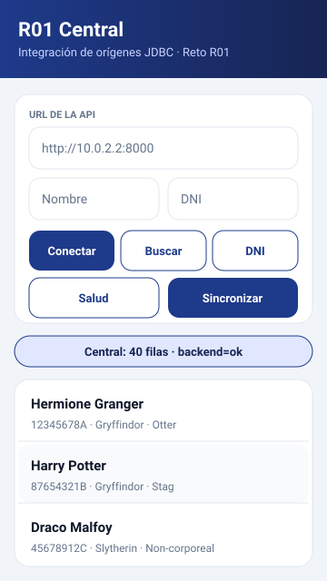

# R01 · Cliente Unity (Patronus)

> **Reto R01** · Cliente Unity sobre `UnityWebRequest` + `JsonUtility` · `R01.Patronus`


## 🎨 Diseño visual (referencia)

Mock de referencia de la UI (misma paleta que Android y JavaFX):
[`docs/diseno-referencia.svg`](docs/diseno-referencia.svg)



| Rol | Hex | Uso en Unity |
|-----|-----|--------------|
| Primario | `#1E3A8A` | Cabecera, botón primario |
| Primario oscuro | `#172554` | Texto de cabecera, estado |
| Primario claro | `#E0E7FF` | Chips / selección |
| Acento | `#06B6D4` | Foco y realces |
| Fondo | `#F1F5F9` | Fondo de escena |
| Superficie | `#FFFFFF` | Tarjetas y filas |
| Borde | `#E2E8F0` | Separadores |
| Texto | `#0F172A` / `#64748B` | Principal / secundario |
| Éxito / Error | `#10B981` / `#EF4444` | Estados de API |

**Tipografía:** sans-serif del sistema · **Radios:** tarjeta 16, campo y
botón 12 · **Rejilla:** 8 px.

### Script de tema

`Assets/Scripts/Ui/TemaR01.cs` expone:

- Los `Color` de la paleta (`TemaR01.Primario`, `TemaR01.Acento`, …).
- `Hex("#RRGGBB")` para convertir colores del manual.
- `AplicarBotonPrimario/BotonSecundario`, `PintarCabecera`, `PintarTexto`.
- `BloqueInteraccion(...)` → `ColorBlock` con normal / pressed / disabled.
- `BotonR01`, componente serializable (fondo + etiqueta) para asignar desde
  el inspector sin escribir código de escena.

> Los prefabs y escenas no se versionan aquí: basta con crear un Canvas uGUI
> y aplicar la paleta con `TemaR01`.

## 🗂️ Estructura

```text
Assets/Scripts/
├── Api/
│   ├── ApiConfig.cs      # base URL, límites de paginación, longitud de DNI
│   └── ApiClient.cs      # MonoBehaviour con todas las llamadas (corutinas)
├── Models/
│   ├── Estudiante.cs     # Estudiante, EstudianteCentral, payload y update
│   └── Pagina.cs         # PaginaOrigen, PaginaCentral, Salud, SyncResumen, errores
├── Ui/
│   └── TemaR01.cs        # paleta y estilo visual compartido (uGUI)
└── EjemploApi.cs         # punto de entrada mínimo (adjuntar a un GameObject)
```

Espacio de nombres: `R01.Patronus`. Copiar la carpeta `Assets/Scripts` en un
proyecto Unity 2021.3 LTS o superior y añadir `EjemploApi` a un GameObject
vacío de la escena inicial.

URL por defecto: `http://127.0.0.1:8000` (cambiable en el inspector o por
`ApiClient.Instancia.UrlBase`).

## 🔌 Operaciones cubiertas (`ApiClient`)

- `GetSalud`, `GetConectores`, `GetConsistencia`
- `GetCentral` y `GetPorDni` (404 devuelto como `ok(null)`)
- `GetOrigen`
- `PostCrear`, `GetObtener`, `PutActualizar`, `DeleteBorrar`
- `PostSync` (todos o un conector)

## ⚙️ Requisitos del backend detectados

- `limit` entre 1 y 500 (por defecto 50) y `offset >= 0`: el cliente
  recorta con `Mathf.Clamp`.
- `dni` máx. 9 caracteres; en la ruta central exige exactamente 9.
- Payloads sin campos extra (`extra="forbid"`); el PUT es parcial y sólo
  informa los campos con valor (`EstudianteUpdate.AJson()`).
- `DELETE` responde 204 sin cuerpo; `POST` responde 201.
- Errores con envelope `{"error": {"codigo", "mensaje", "detalle"}}`,
  traducidos por `ApiClient.MensajeError`.

## ⚠️ Limitación de JsonUtility

`GET /connectors` y `GET /central/consistencia` devuelven diccionarios con
claves dinámicas, que `JsonUtility` no puede deserializar; por eso se
expusieron como JSON crudo (`GetConectores`, `GetConsistencia`) para
parsearlos con `MiniJSON` o `Newtonsoft.Json` si hace falta.
