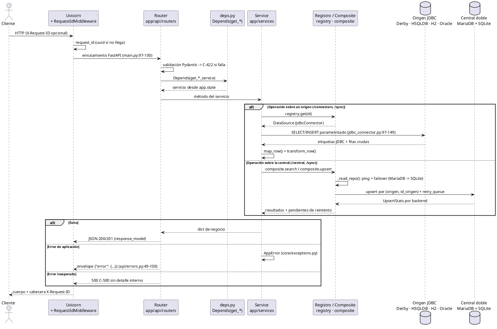

# 06 — Arquitectura del backend: recorrido de una petición y ciclo de vida

**Versión:** 1.0 · **Fecha:** 2026-10-01
**Componente:** `r01/backend` (`app/main.py`, `app/api/`, `app/services/`, `app/persistence/`, `app/data_access/`)

> **Trazabilidad:** anexo del conjunto de manuales de `r01/docs`.
> Todas las citas `archivo:línea` corresponden al código real del repositorio;
> el diagrama se acompaña en [`flujo-peticion-backend.puml`](flujo-peticion-backend.puml)
> con `pragma layout Smetana`.

---

## Índice

1. [Arquitectura por capas](#1-arquitectura-por-capas)
2. [Recorrido de una petición de extremo a extremo](#2-recorrido-de-una-petición-de-extremo-a-extremo)
3. [Diagrama de flujo (PlantUML · Smetana)](#3-diagrama-de-flujo-plantuml--smetana)
4. [Ciclo de vida de `create_app`](#4-ciclo-de-vida-de-create_app)
5. [Tabla resumen de referencias](#5-tabla-resumen-de-referencias)

---

## 1. Arquitectura por capas

| Capa | Paquete | Piezas principales | Consume | Es consumida por |
|------|---------|--------------------|---------|------------------|
| **API** | `app/api/` | `routers/` (4 routers), `schemas/`, `deps.py`, `errors.py` | Servicios | Uvicorn / cliente HTTP |
| **Servicios** | `app/services/` | `connector_service.py`, `central_service.py`, `sync_service.py`, `transform.py` | `DataSource`, `CompositeCentralRepository`, `ConnectorRegistry` | `app/api/deps.py` |
| **Persistencia** (central) | `app/persistence/` | `db.py`, `models.py`, `repositories/` | SQLAlchemy / engines | `app/services/*` y `app/main.py` |
| **Acceso a datos** (orígenes) | `app/data_access/` | `registry.py`, `jdbc_connector.py`, `dialects.py`, `base.py` | JDBC + JVM (JPype) | `app/services/*` y `app/main.py` |
| **Núcleo** | `app/core/` | `config.py`, `exceptions.py`, `middleware.py`, `logging_config.py` | — | Todas las capas |

**Reglas de dependencia** (las flechas sólo apuntan hacia abajo):

```text
app/api  ──Depends()──▶  app/services  ──▶  app/persistence   (central doble)
                                   └─────▶  app/data_access    (orígenes JDBC)
app/core  ◀── importan todas las capas────
```

* `app/api/` **nunca** importa `persistence` ni `data_access`: sólo conoce servicios
  (`app/api/deps.py:7-9`).
* `app/services/` **nunca** importa `fastapi`: es código de negocio puro, testeable
  sin levantar el servidor (`tests/unit/`).
* La composición de todo (quién se conecta con quién) ocurre **una única vez**,
  en `create_app` (`app/main.py:34-111`).

---

## 2. Recorrido de una petición de extremo a extremo

### 2.1 Ejemplo A — `GET /central/estudiantes?nombre=alicia`

| # | Fase | Qué ocurre | Referencia |
|---|------|------------|------------|
| 1 | Transporte | Uvicorn entrega la petición al pipeline ASGI. | — |
| 2 | Middleware | `RequestIdMiddleware` toma o genera el `X-Request-ID`, lo guarda en `request.state` y cronometra la llamada. | `app/core/middleware.py:28-32` |
| 3 | Enrutado | FastAPI casa la URL con `router = APIRouter(prefix="/central")`; el router se registró en el arranque. | `app/api/routers/central.py:13`, `app/main.py:100` |
| 4 | Validación de entrada | Los `Query(...)` validan tipos y longitudes (`offset ≥ 0`, `1 ≤ limit ≤ 500`). Si falla, se dispara `RequestValidationError` → envelope `C-422`. | `app/api/routers/central.py:18-21`, `app/api/errors.py:63-77` |
| 5 | Inyección de dependencias | `Depends(get_central_service)` devuelve el servicio singleton montado en el `lifespan`. | `app/api/deps.py:17-19`, `app/main.py:73` |
| 6 | Servicio | `CentralService.buscar()` valida de nuevo paginación, normaliza `nombre`/`dni` y pide página + total. | `app/services/central_service.py:28-59` |
| 7 | Repositorio compuesto | `CompositeCentralRepository.search()` elige el backend de lectura con `_read_repo()` (ping a MariaDB y, si falla, a SQLite). | `app/persistence/repositories/composite.py:115-125`, `104-113` |
| 8 | Repositorio SQL | `SqlCentralRepository.search()` construye el `select` con filtros, `order_by`, `offset` y `limit`, y materializa `as_dict()`. | `app/persistence/repositories/base.py:164-184` |
| 9 | Respuesta | El dict se valida con `response_model=PaginaCentral` y se serializa a JSON 200. | `app/api/routers/central.py:16`, `app/api/schemas/estudiante.py:113-121` |
| 10 | Salida | El middleware añade `X-Request-ID` y registra método, ruta, estado y duración. | `app/core/middleware.py:46-55` |

**Camino de error (mismo ejemplo, DNI inexistente):** el servicio lanza
`NoEncontradoError` (`app/services/central_service.py:65-69`), que hereda de
`AppError` (`app/core/exceptions.py:41-45`); el handler global la convierte en
HTTP 404 con envelope `{"error": {"codigo": "C-404", ...}}`
(`app/api/errors.py:52-61`).

### 2.2 Ejemplo B — `POST /sync/{connector_id}` (el más largo)

| # | Fase | Qué ocurre | Referencia |
|---|------|------------|------------|
| 1 | Ruta + dependencia | `router.post("/sync/{connector_id}")` → `get_sync_service`. | `app/api/routers/sync.py:16-26` |
| 2 | Reintentos previos | Antes de leer nada, se reintentan los upserts que quedaron pendientes del fallo anterior. | `app/services/sync_service.py:41` → `composite.py:73-98` |
| 3 | Obtención del origen | `registry.get(id)` devuelve el `JdbcConnector` o lanza 404. | `app/data_access/registry.py:144-152` |
| 4 | Paginación | `count()` + bucle `while offset < total` llamando a `list(offset, limit)` con `page_size` del `Settings`. | `app/services/sync_service.py:49-68`, `app/core/config.py:62` |
| 5 | Sentencia JDBC | `list()` compone `SELECT ... OFFSET/FETCH` con parámetros `?` y dialecto del conector. | `app/data_access/jdbc_connector.py:199-212`, `app/data_access/dialects.py:31-35` |
| 6 | Mapeo de columnas | `map_row()` traduce etiquetas JDBC → campos del modelo y convierte tipos (`int`/`str`). | `app/data_access/dialects.py:87-117` |
| 7 | Transformación | `transform_row()` normaliza y valida; una fila inválida **no aborta** el sync: se cuenta como error. | `app/services/sync_service.py:55-67`, `app/services/transform.py:61-86` |
| 8 | Upsert dual | `CompositeCentralRepository.upsert()` escribe en MariaDB **y** SQLite; si uno falla, marca las filas en la cola de reintentos. | `app/persistence/repositories/composite.py:57-71` |
| 9 | Resumen | Se construye `SyncResumen` (leídos, insertados, actualizados, errores, pendientes, duración). | `app/services/sync_service.py:74-92`, `104-148` |
| 10 | Respuesta | Pydantic valida con `response_model=SyncResumen` y devuelve JSON 200. | `app/api/schemas/salud.py:43-52` |

---

## 3. Diagrama de flujo (PlantUML · Smetana)

Fuente: [`flujo-peticion-backend.puml`](flujo-peticion-backend.puml).



**Puntos que representa el diagrama:**

1. El middleware es el **primer** y el **último** elemento de la tubería.
2. El router **sólo** delega: toda la lógica vive en servicios.
3. Cada servicio elige **un único** cuello de botella inferior
   (`DataSource` para orígenes, `CompositeCentralRepository` para la central).
4. Cualquier fallo converge en el **mismo** envelope de error.

---

## 4. Ciclo de vida de `create_app`

`app/main.py` define la fábrica `create_app(settings=None, registry=None)`
(`app/main.py:34-37`) y la ejecuta al importar el módulo
(`app/main.py:114`: `app = create_app()`), que es lo que permite el arranque
`python -m uvicorn app.main:app --port 8000`.

### 4.1 Fases

| Fase | Cuándo | Qué ocurre | Referencia |
|------|--------|------------|------------|
| **F0 · Importación** | `import app.main` | Se ejecuta `create_app()` a nivel de módulo. | `app/main.py:114` |
| **F1 · Construcción** | Dentro de `create_app()` | Resuelve `Settings`, configura logging, crea `FastAPI(...)` con el `lifespan`, añade el middleware, instala los handlers de error y registra los 4 routers + la raíz `GET /`. | `app/main.py:45-46`, `88-100`, `102-109` |
| **F2 · Arranque (`lifespan` entrada)** | Primer ciclo del servidor (evento `startup`) | Engines → esquema → cola de reintentos → repos → registro de conectores (JVM) → servicios en `app.state` → log de arranque. | `app/main.py:48-82` |
| **F3 · Servicio** | Mientras hay peticiones | Los routers piden servicios con `Depends`; el `app.state` es de solo lectura. | `app/api/deps.py:12-24` |
| **F4 · Apagado (`lifespan` salida)** | `Ctrl+C` / fin del servidor | Se disponen los engines SQLite y MariaDB. | `app/main.py:84-86` |

### 4.2 Detalle de la fase F2 (la más relevante)

```python
# app/main.py:48-86 (resumen anotado)
@asynccontextmanager
async def lifespan(app: FastAPI):
    engines = build_engines(app_settings)   # engines lazy (sin conexiones aún)
    init_schema(engines)                    # create_all + ping de MariaDB
    retry_queue = SqliteRetryQueue(engines.sqlite)
    repos = []                              # MariaDB (si está disponible) + SQLite
    if engines.mariadb is not None:
        repos.append(MariaDbRepository(engines.mariadb))
    repos.append(SqliteRepository(engines.sqlite))
    central_repo = CompositeCentralRepository(repos, retry_queue)
    conectores = registry or ConnectorRegistry.load(...)   # ← arranque JVM
    app.state.settings = app_settings
    app.state.central = central_repo
    app.state.registry = conectores
    app.state.connector_service = ConnectorService(conectores)
    app.state.central_service = CentralService(central_repo)
    app.state.sync_service = SyncService(conectores, central_repo, page_size=...)
    yield                                   # ← la app queda sirviendo peticiones
    for engine in (engines.sqlite, engines.mariadb):
        if engine is not None:
            engine.dispose()                # F4: cierre ordenado
```

### 4.3 Decisiones de diseño del ciclo de vida

| Decisión | Motivo | Referencia |
|----------|--------|------------|
| Todo el montaje vive en `lifespan`, no en el cuerpo de `create_app` | Evita crear conexiones/JVM al importar el módulo (los tests importan `app.main` sin efectos secundarios). | `app/main.py:48-86` |
| Parámetros `settings` y `registry` opcionales | Las pruebas inyectan `Settings` de prueba y un `ConnectorRegistry` con orígenes falsos **sin arrancar la JVM**. | `app/main.py:34-44`, `tests/conftest.py` |
| `ConnectorRegistry.load()` sólo se llama si no se inyecta | El arranque de la JVM es el paso más frágil y el más lento. | `app/main.py:62-66` |
| `init_schema()` tolera MariaDB caído | La central sigue operativa con SQLite y el estado se refleja en `/health`. | `app/persistence/db.py:45-67` |
| `app.state` como contenedor de singletons | No hay contenedor de dependencias: los servicios se construyen una vez y se leen con `Depends`. | `app/main.py:68-76`, `app/api/deps.py` |
| Los engines se disponen al apagado | Evita ficheros SQLite bloqueados y conexiones colgadas en reinicios en caliente. | `app/main.py:84-86` |

> **Verificación rápida para la revisión:**
> arrancar con `python -m uvicorn app.main:app --port 8000` y comprobar que el
> log de arranque recoge `Aplicación arrancada: conectores=... jvm=...`
> (`app/main.py:77-82`), que `GET /health` devuelve 200 y que `GET /docs`
> muestra los cuatro grupos de endpoints.

---

## 5. Tabla resumen de referencias

| Concepto | Fichero principal | Líneas clave |
|----------|-------------------|--------------|
| Fábrica y `lifespan` | `app/main.py` | 34-111, 114 |
| Middleware de trazabilidad | `app/core/middleware.py` | 17-56 |
| Envelope de errores | `app/core/exceptions.py` · `app/api/errors.py` | 13-59 · 21-100 |
| Inyección de servicios | `app/api/deps.py` | 12-24 |
| Servicio de sincronización | `app/services/sync_service.py` | 30-148 |
| Repositorio compuesto (failover) | `app/persistence/repositories/composite.py` | 57-164 |
| Registro y JVM | `app/data_access/registry.py` | 27-50, 75-139 |
| Conector JDBC | `app/data_access/jdbc_connector.py` | 66-149, 199-274 |
| Dialectos y mapeo | `app/data_access/dialects.py` | 24-117 |

---

**Documentos relacionados:** [`01-README.md`](01-README.md) ·
[`04-manual-api-arquitectura.md`](04-manual-api-arquitectura.md) ·
[`07-piezas-complejas.md`](07-piezas-complejas.md)
